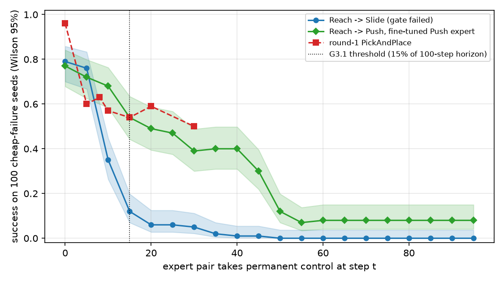

# Long-Horizon Composition (Reach → Slide): verify first, compose second

**Result in one line:** both sub-skills were verified, composed and checked. The composed task **fails the Part 3 horizon and rescue gates**. Failure becomes irreversible within about 5–10 steps of the Slide phase starting (median step 10 of a 100-step horizon), so as the brief requires, **no calibration or benchmark compute was spent.** The Push leg the brief proposed was rejected at Part 1: no Push checkpoint reaches 80% success.

This is a separate track: **do not pool with LIBERO, RoboTurk, or the earlier panda-gym rounds.** Code is in `panda_gym_demo/composed/` (`verify_subskills.py`, `compose.py`, `part2_compose_check.py`, `part4a_distill.py`, `part3_horizon_rescue.py`, `make_fig_rescue.py`); results are in `composed/results/`.

---

## 1. Sub-skill verification (Part 1)

Protocol: 50 episodes per checkpoint in the **sparse v3 env**, with native `max_episode_steps` = 50 and success-termination, deterministic actions. Success is measured from `info["is_success"]`. Bar: ≥ 0.80 success.

| Task | Checkpoint | Algo | Success | Wilson 95% | Steps to success (median / p90 / max) | Verdict |
|---|---|---|---|---|---|---|
| Reach | `chencliu/tqc-PandaReach-v3` | TQC | **50/50** | [0.93, 1.00] | 3 / 4 / 4 of 50 | ✅ **selected** |
| Reach | `ThomasSimonini/a2c-PandaReachDense-v3` | A2C | 50/50 | [0.93, 1.00] | 3 / 4 / 5 | ✅ |
| Reach | `sagarsdesai/a2c-PandaReachDense-v3` | A2C | 50/50 | [0.93, 1.00] | 3 / 4 / 4 | ✅ |
| Push | `enaitzb/TQC-PandaPush-v3` | TQC | 38/50 = 0.76 | [0.63, 0.86] | 9.5 / 21 / 35 | ❌ borderline → re-measured below |
| Push | ↳ re-measured on **200 fresh seeds** (bar unchanged) | TQC | **143/200 = 0.715** | [0.65, 0.77] | 9 / 20 / 42 | ❌ **rejected** |
| Push | `enaitzb/TQC-PandaPush-v3` (alternative `no_load_env` zip) | TQC | 38/50 | [0.63, 0.86] | same as above | ❌ |
| Push | `enaitzb/TQC_no_envs-PandaPush-v3` (the "−45 ± 15" checkpoint) | TQC | 2/50 | [0.01, 0.13] | 1 | ❌ broken |
| Push | `Mriganka1999/…usingSAC-PandaPushDense-v3` | SAC | 2/50 | [0.01, 0.13] | 1 | ❌ broken |
| Push | `Mriganka1999/…usingTD3-PandaPushDense-v3` | TD3 | 2/50 | [0.01, 0.13] | 1 | ❌ broken |
| Slide (third candidate) | `chencliu/tqc-PandaSlide-v3` | TQC | **48/50 = 0.96** | [0.87, 0.99] | 12 / 14 / 16 of 50 | ✅ **selected** |

**Notes on the rejected Push checkpoints:**
- **The "2/50" checkpoints are effectively broken.** Their only successes end at step 1, meaning the object already started within the goal threshold.
- **The reward number misleads.** The brief's "−45 ± 15" checkpoint is one of them. Its reward looked usable; measured success shows it is not.
- **The bar was not lowered for Push.** The borderline TQC checkpoint dropped further on a larger sample (0.76 → 0.715).

**Selected pair:** Reach (TQC, 5.4k-parameter actor) → Slide (TQC, 541k-parameter actor). Round 1's PickAndPlace checkpoint was not reused.

---

## 2. Composition and its own success check (Part 2)

### Construction (`compose.py`)
- **One `PandaSlide-v3` scene.** The robot base [−0.6, 0, 0], blocked gripper and 3-D action space are identical across Reach and Slide (checked in the panda-gym source).
- **Phase A, Reach.**
  - The goal is sampled from PandaReach's own box, [±0.15]² × [0, 0.3], using a per-seed RNG. That box overlaps the puck's start region, so the arm *can* disturb the puck.
  - Policy A sees exactly Reach's observation.
  - Success means ‖ee − goal‖ < 0.05 within 50 steps. **If phase A fails, the episode ends as a failure.**
- **Phase B, Slide.** It starts from wherever phase A left the arm and puck. Policy B sees Slide's native observation, with a 50-step budget and Slide's own success test.
- **Episode.** Success requires both phases to succeed, so the horizon is at most 100 steps. Each phase ends on its own success, matching the termination the sub-skills were verified under.

### Checks with both experts unmodified (n = 200)

| | Value |
|---|---|
| **Composed success (measured)** | **173/200 = 0.865** [0.81, 0.91] |
| Product of sub-skill rates | 1.00 × 0.96 = 0.96 |
| Failures by phase | reach 0, slide 27 |
| Episode length | median 16, mean 21.3, max 54; reach phase takes a median of 3 steps |

**Boundary-state validity:**
- The puck moved at most **0.26 mm** during phase A; reach never disturbed it.
- The puck is resting at the boundary: its centre height is 0.015–0.022 against a 0.015 resting height, with zero airborne or off-table cases.
- End-effector height at the boundary ranges from 0.02 to 0.28 m.
- Rendered frames confirm sensible configurations (`figures/phase_boundary_frames.png`).
- *An earlier version of this check used the wrong resting height (0.03) and flagged 189 "off-table" pucks. That was a bug in the check, not in the task, and has been fixed.*

**Why composed success (0.865) sits below the product (0.96): distribution shift at the boundary, diagnosed rather than patched.**
- **Paired test on the same 200 seeds** (same puck and goal): Slide from its *native* start pose succeeds **0.995**; from the Reach end-pose it succeeds 0.865. That is 27 native-only successes against 1 composed-only, McNemar p = 2e−7.
- **Success falls as the Reach end-pose moves further from Slide's home pose.** Across terciles of that distance: **1.00 → 0.89 → 0.70**.
- **Cause:** policy B was never trained to start from arbitrary end-effector positions.

Per §2.3, fine-tuning is the fix *if composed success is very low*. At 0.865 the composed expert remains competent, so it was kept **unmodified** and the shift is reported here.

---

## 3. Horizon and rescue diagnostics (Part 3): **GATE FAILED**

### Cheap policy used for the diagnostics
- **Distillation:** a round-1-style MLP (23→64→64→3, 5.6k parameters) trained on composed-expert rollouts.
- **Budget:** 10 000 steps, chosen by the round-1 budget rule's fallback. No budget reached success ≥ 0.30 while staying 0.20 below the expert; the success rates were 1k: 0.12, 2k: 0.23, 5k: 0.16, 10k: 0.28.
- **Performance:** 0.28 [0.24, 0.32] success on 500 diagnostic episodes; reach succeeds 99%.

### 3.1 Horizon diagnostic (500 cheap episodes)

| | median | p10 | p90 |
|---|---|---|---|
| Phase A (reach) success step | 3 | 2 | 4 |
| Episode success step (successes) | 17 | 13 | 22 |
| Phase B steps to success | 15 | 10 | 19 |
| Terminal step of failures | 53 | 52 | 54 |

Failures: 355 in slide, 5 in reach. Failures run to the budget because the episode only ends when phase B's budget is exhausted, but they are decided much earlier (see the per-seed irreversibility step below).

### 3.2 Rescue curve (100 cheap-failure seeds; expert pair takes permanent control from step t)

| t | 0 | 5 | **10** | **15** | 20 | 25 | 30 | 35 | 40 | 45 | ≥ 50 |
|---|---|---|---|---|---|---|---|---|---|---|---|
| R(t) | 0.79 | 0.76 | **0.35** | **0.12** | 0.06 | 0.06 | 0.05 | 0.02 | 0.01 | 0.01 | 0.00 |

### Pre-registered gates (fixed in `part3_horizon_rescue.py` before it ran)

| Gate | Criterion | Measured | Pass? |
|---|---|---|---|
| **G3.1 horizon** | median irreversibility step > 15 (15% of horizon) **and** IQR ≥ 10 | median **10**, IQR **5** (p10 5, p90 15; n = 79 seeds rescuable at t = 0) | ❌ |
| **G3.2 rescue** | R(0) ≥ 0.70 | 0.79 | ✅ |
| | D = R(0) − R(95) ≥ 0.30 | 0.79 | ✅ |
| | largest single 5-step drop ≤ 0.5·D (0.395) | **0.41** (t = 5 → 10) | ❌ |
| | ≥ 3 grid points at t ≥ 10 inside the middle band [0.20, 0.59] | **1** (t = 10) | ❌ |

**Both gates fail → do not proceed to Part 4/5.** Parts 4 and 5 (calibration, arbitration, four-way benchmark) were deliberately **not run.** That spares a full calibration and benchmark cycle on a task the diagnostic already rules out.

### What the diagnostic shows
- **A real timing effect exists, unlike round 1.** Round 1's curve dropped at t = 5 and then stayed flat around 0.55 regardless of timing. Here, handover at step 5 rescues 76% of failures; handover at step 10 rescues 35%, and at 15 only 12%. Across the 100 seeds, 47 are rescuable at t = 5 but not at t = 10, and 27 more are lost between t = 10 and 15.
- **But the window is about 5–10 steps wide and sits at the very start of the Slide phase.** Reach finishes at step 3. The cheap policy then strikes the puck within a few steps, and a mis-struck puck slides out of recoverable range, since Slide is by design a one-shot, low-friction task.
- **Composition did not lengthen the decision window, only the episode.** The reach leg adds 3 near-certain steps before the window, and the 100-step budget adds dead time after it. The meaningful decision is still made in roughly steps 5–10.

---

## 4. Conclusion and recommendation

1. **Verified sub-skills:** Reach (3 checkpoints, all 100%) and Slide (96%). **Push is rejected**: its best checkpoint measures 0.715 on 200 episodes, and the others are broken.
2. **Composed Reach → Slide:** a valid task. The expert pair reaches 0.865 success, below the 0.96 product because of a measured boundary distribution shift in Slide's start pose.
3. **Suitability for arbitration: no.** Failure becomes irreversible by a median of step 10 of 100 (IQR 5), and the rescue curve is a cliff between t = 5 and t = 15, not a graded middle regime. **Per the brief, calibration and benchmark were not run.**

**Recommendation.** Reconsider the composition, not the arbiter. What's missing is a sub-skill whose errors stay *recoverable for longer*. The failure modes seen so far: PickAndPlace resolves in about 7 steps, and Slide fails irreversibly on the first strike.

The natural candidate is **Push**, because a mis-pushed object can be pushed again. It is blocked only by the lack of a checkpoint that reaches ≥ 80% success. Two options, both new work needing their own verification:
- **(a)** Train or obtain a Push expert and verify ≥ 80% directly before composing (e.g. Reach → Push or Push → Push to a second goal).
- **(b)** Move to a genuinely long-horizon benchmark, where the LIBERO track already lives.

Chaining more near-instant sub-skills, for example extra Reach waypoints, would lengthen episodes without widening the window, so it is not recommended.

## 5. Non-pooling reminder
These results come from one composed panda-gym task with its own checkpoints, cheap policy and seeds. They are **not to be pooled** with LIBERO, RoboTurk, or the round-1 and iteration-1/2 panda-gym numbers. The LIBERO track remains the project's statistically powered result.
