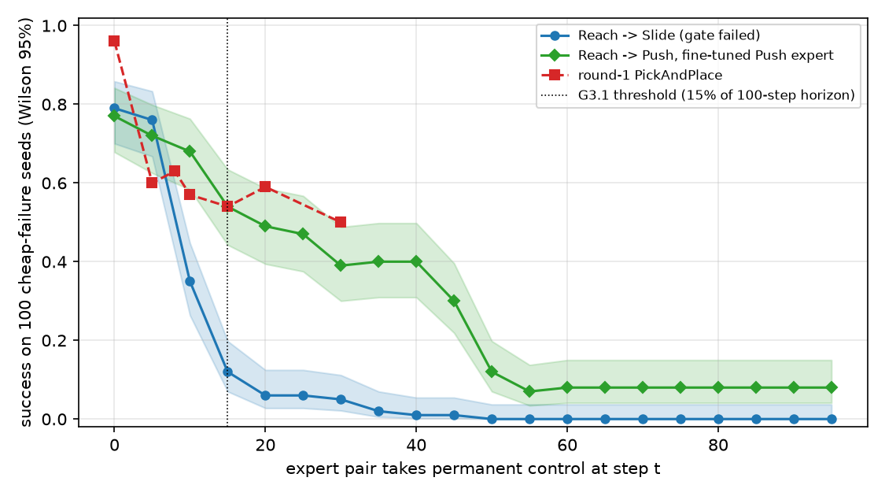

# Recommended change executed: verified Push expert → Reach → Push composition

**Result in one line:**
- **Done:** a Push expert now **genuinely passes the ≥80% bar** (0.90 on 200 fresh seeds, after fine-tuning), and the Reach → Push composition has the **graded rescue regime the brief asked for**. G3.2 passes clearly.
- **Blocked:** the composition misses the horizon gate G3.1 by the narrowest margin. The median irreversibility step is exactly 15 against a pre-registered "> 15".
- **Calibration and the benchmark were not run**, per the standing rule, and the pre-registered statistic turns out to be confounded (§4). **Whether to proceed is a decision for the user**; see §6.

This is the follow-up to `results/REPORT_composed_longhorizon.md`, recommendation (a). Separate track: **do not pool** with LIBERO, RoboTurk, or the earlier panda-gym rounds.

---

## 1. Push expert: fine-tuned, then verified on fresh seeds

**Starting point:** `enaitzb/TQC-PandaPush-v3`, the best Push checkpoint found. It measured **0.715** on 200 seeds and was rejected. It had been trained for only **125k env steps**; rl-zoo's reference recipe uses 1M.

### What was tried (`train_push.py`, logs `results/push_finetune_log_run{1,2}.json`)

| Attempt | Setup | Outcome |
|---|---|---|
| Smoke test | the checkpoint's own settings (1 env, batch 2048, lr 1e-3) + **empty replay buffer** (buffers aren't saved in SB3 zips) | **collapsed**: eval 0.78 → 0.18 within 3k steps; 24 env-steps/s |
| Profiling | — | about 30 gradient updates/s regardless of batch size (HER sampling on CPU dominates); GPU installed into the venv (torch 2.5.1+cu121, RTX 3050) |
| Run 1 | 8 envs, pre-fill 50k, lr 1e-4, 0.25 updates per env step | stable but **flat**: eval 0.78 / 0.76 / 0.72 / 0.76 / 0.77 / 0.75 over 250k steps; stopped |
| **Run 2** | resumed from run 1 @250k; pre-fill 100k, **lr 3e-4, 0.5 updates per env step** | eval 0.75 → 0.81 → 0.81 → 0.85 → 0.87 → 0.84 → 0.83 → **0.90 @350k** (target reached, 87 min) |

**Selection vs verification:**
- **Selection:** the checkpoint was chosen on evaluation seeds 170000–170099.
- **Verification:** it was then tested on **200 fresh seeds** (200000–200199) with the Part 1 protocol (sparse env, native TimeLimit, deterministic actions). The bar stayed at 0.80.

| Checkpoint | Fresh-seed success | Wilson 95% | Steps to success (median / p90) |
|---|---|---|---|
| Original `enaitzb/TQC-PandaPush-v3` (same 200 seeds) | 0.685 | — | — |
| **Fine-tuned (run 2 @350k)** | **180/200 = 0.90** | [0.85, 0.93] | 8 / 17 |

Paired comparison on the same seeds: 51 fine-tuned-only successes vs 8 original-only, exact McNemar **p = 9e−9**. → **Push passes the bar.** It is a 541k-parameter actor, the same architecture as before.

---

## 2. Composition Reach → Push (Part 2), experts unmodified

**Construction:** identical to Reach → Slide, except the scene is `PandaPush-v3` and phase B is Push. Phase A must succeed within 50 steps or the episode fails; phase B has a 50-step budget.

| | Reach → Push | (Reach → Slide, for reference) |
|---|---|---|
| **Composed success, measured (n = 200)** | **178/200 = 0.89** [0.84, 0.93] | 0.865 |
| Product of sub-skill rates | 1.00 × 0.90 = 0.90 | 0.96 |
| Failures by phase | reach 0 / push 22 | reach 0 / slide 27 |
| Episode length (median / max) | 12.5 / 54 | 16 / 54 |
| Object displaced by reach | max 0.02 mm, 0 off-table | max 0.26 mm |

**Boundary distribution shift: none detected for Push.**
- **Paired test.** On the same seeds, Push from its native start succeeds 0.895 vs 0.89 composed (18 vs 17 discordant, p = 1.0). Push is robust to where Reach leaves the arm; Slide was not.
- **Residual effect.** Only the farthest tercile of end-effector shift shows some drop (0.94 / 0.94 / 0.79).
- **No fine-tuning of the phase-B policy was needed.**

Frames: `figures/phase_boundary_frames.png`.

---

## 3. Cheap policy (round-1 rule, unchanged)

- **Architecture:** MLP 23→64→64→3, trained by behaviour cloning on composed-expert rollouts.
- **Budget rule result:** the rule chose **2 000 steps**, the smallest budget with success ≥ 0.30 that is also ≥ 0.20 below the expert.

| Budget (steps) | 1k | **2k** | 5k | 10k |
|---|---|---|---|---|
| Selection success | 0.22 | **0.45** | 0.54 | 0.71 |

- **Performance on 500 diagnostic episodes:** **0.41** [0.37, 0.45]. Reach succeeds 97.4%; failures are 282 in push and 13 in reach.

---

## 4. Horizon and rescue diagnostics (Part 3): G3.2 passes, G3.1 misses at the boundary

### Rescue curve (100 cheap-failure seeds; expert pair takes permanent control from step t)

| t | 0 | 5 | 10 | 15 | 20 | 25 | 30 | 35 | 40 | 45 | 50 | ≥ 55 |
|---|---|---|---|---|---|---|---|---|---|---|---|---|
| **Reach → Push** | 0.77 | 0.72 | 0.68 | **0.54** | 0.49 | 0.47 | 0.39 | 0.40 | 0.40 | 0.30 | 0.12 | 0.07–0.08 |
| Reach → Slide | 0.79 | 0.76 | 0.35 | 0.12 | 0.06 | 0.06 | 0.05 | 0.02 | 0.01 | 0.01 | 0.00 | 0.00 |

**What the curve shows:**
- **A graded decline across t = 5 to 45.** The expert can still rescue about 40% of cheap failures 30–40 steps in. The late drop (t = 45 → 55) is the phase-B step budget running out.
- **It differs from both earlier failures:**
  - Round 1 was flat after t = 5, so timing didn't matter.
  - Reach → Slide was a cliff at t = 5–10, so the window was too short.
- **It matches the brief's description of a timing-sensitive window.**

### Pre-registered gates (unchanged from the Reach → Slide run; R(0) floor = 0.8 × composed expert rate)

| Gate | Criterion | Measured | Pass |
|---|---|---|---|
| G3.1 horizon | median irreversibility step **> 15** | **15.0** | ❌ (boundary) |
| | IQR ≥ 10 | 15 (p10 5, p90 45) | ✅ |
| G3.2 rescue | R(0) ≥ 0.71 | 0.77 | ✅ |
| | D = R(0) − R(95) ≥ 0.30 | 0.69 | ✅ |
| | largest 5-step drop ≤ 0.5 D (0.345) | 0.18 (t = 45 → 50) | ✅ |
| | ≥ 3 points at t ≥ 10 in band [0.25, 0.60] | 7 (t = 15 … 45) | ✅ |

**Overall: G3.1 fails, so by the standing rule, do not proceed.** `part45_calib_bench.py` enforces this and exits.

### Why the G3.1 miss is ambiguous rather than decisive (diagnostics, **not** substitute gates)
1. **The per-seed rescue outcome is not monotone in t.**
   - For **57 of 77** seeds rescuable at t = 0, a handover fails at some step and then *succeeds* at a later step.
   - The pre-registered statistic, "first grid t at which handover fails", therefore records transient misses as irreversibility and biases the step downward.
   - Alternative readouts on the same data: last rescuing t, median **40** (IQR 20); fraction of grid points rescued, median 30%.
2. **The simulator replay is not deterministic for Push.**
   - Re-running the cheap policy alone on the 100 "cheap-failure" seeds gives **8 successes** (in order), 7 (reversed order) and 11 (fresh env per episode). Round-1 PickAndPlace showed 1 in 400.
   - PyBullet contact dynamics carry state between resets, so the 0.07–0.08 floor at t ≥ 55 is replay noise, not rescue.
   - The same noise contributes to the non-monotonicity above.
3. **The brief's own wording describes a pattern this curve doesn't show.** It targets failure steps that "cluster in the first 10–15% of the episode *with little spread*". Here the spread is p10 = 5 to p90 = 45 with an IQR of 15. The operational threshold ("> 15") was mine, and it lands exactly on the boundary.

None of these points changes the pre-registered verdict. They are reported so the decision in §6 is informed.

---

## 5. What changed vs the previous report, in brief
- **Push rejected → Push verified.** 0.715 → 0.90 on fresh seeds, via fine-tuning a clearly under-trained checkpoint; significant vs the original on paired seeds.
- **Reach → Slide → Reach → Push.**
  - Composed expert: 0.865 → 0.89.
  - Boundary distribution shift: significant → none.
  - Rescue curve: cliff → graded window. G3.2 fail → **pass**; G3.1 misses at the boundary (median 10 → 15).
- **Not run:** Part 4 (calibration) and Part 5 (four-way benchmark with the matched random control). The scripts are written and gated.

## 6. Decision needed
Two defensible options:
- **(i) Stop here (the pre-registered outcome).** The report stands as written. Reach → Push is a much better arbitration testbed than anything before, but it did not formally pass G3.1.
- **(ii) Proceed to Parts 4–5 as an explicitly disclosed gate override.** Grounds: G3.2 passes clearly, G3.1 misses by exactly one boundary value, and its statistic is confounded as shown in §4. The benchmark (cheap, expert, arbitrated, retuned matched random control, paired tests) would be reported with the override stated at the top. Estimated runtime is about 45–60 min.

## 6b. User decision: option (ii), proceed with the gate override disclosed

---

## 6c. Determinism fix, found before the benchmark (supersedes the replay caveats in §4)

The benchmark smoke test showed an arbiter that never escalated, yet its success differed from cheap-alone on the same seeds. A direct test (`results_push/determinism_check.json`, 40 seeds, run order reversed) located the cause:

| Env handling | Success flips | Trajectories differing |
|---|---|---|
| One shared env, `env.reset(seed)` each episode (all runs up to §4) | 7 / 40 | 36 / 40 |
| **Fresh env per episode** | **0 / 40** | **0 / 40** |

- **Cause:** PyBullet carries hidden state across `reset()`. It is not intrinsic nondeterminism, and it's fixable without switching simulators.
- **Fix:** `DETERMINISTIC_RESET` now rebuilds the env every episode, at about 0.16 s per episode. It is the default for Reach → Push from here on.
- **Part 3 re-run deterministically.** The noisy version is kept as `part3_horizon_rescue_SHAREDENV_noisy.json`.
  - Rescue curve: R = 0.78 → … → **0.00** at t ≥ 55. The 0.08 floor is gone, confirming it was replay noise.
  - **G3.2 passes** on all four checks.
  - **G3.1 still fails at the boundary:** median irreversibility step 15.0, IQR 20.
  - **66% of seeds remain non-monotone**, so that part is genuine contact sensitivity, not noise.
- **Not re-run:** the cheap-policy selection (§3) and composed-expert check (§2) used the shared env. They are not re-run; the benchmark below re-measures both baselines deterministically.

---

## 8. Calibration and four-way benchmark (Parts 4–5): **run under a disclosed gate override**

> **Override:** G3.1 FAILED (median 15.0, pre-registered "> 15"; IQR 20); G3.2 passed. Parts 4–5 were run on the user's explicit authorisation. The override text is stored in `part45_benchmark.json["gate_override"]`.

Setup (round-1 methodology, unchanged):
- **Phases and score:** K = 2, reach / push, defined by the composition's causal phase switch. Score = commanded-vs-achieved compliance residual with the motion-floor mask (2.1% of steps below the floor).
- **Calibration:** successful cheap episodes, all with deterministic resets.
- **Arbiter:** `scp.arbitration` hysteresis, hold = 8, chunk = 1.
- **Random control:** retuned on separate tune seeds to each arbiter's realised expert fraction.
- **Benchmark:** 500 paired held-out seeds.

### Calibration
- **Data:** 600 cheap calibration episodes; **256** successful, non-degenerate episodes kept (0 degenerate).
- **Feasibility:** n ≥ 19 required → feasible.

| | reach | push |
|---|---|---|
| q̂ (α = 0.10) | 1.492 | 1.452 |
| q̂_esc (α_esc = 0.20 / **0.30** / 0.40) | 1.309 / **1.237** / 1.133 | 1.348 / **1.207** / 1.153 |

q̂_esc < q̂ holds in both phases at every level.

### Benchmark (n = 500 paired seeds, Wilson 95%)

| Condition | Success | **Expert-step fraction** | Episodes escalated | First escalation (median step) |
|---|---|---|---|---|
| 1. Cheap alone | 0.436 [0.393, 0.480] | 0.000 | — | — |
| 2. Expert pair alone | 0.840 [0.805, 0.870] | 1.000 | — | — |
| **3. Arbitrated, α_esc 0.30** | **0.530** [0.486, 0.573] | **0.128** | 31% | 4 |
| **4. Random, retuned, 0.30** | **0.504** [0.460, 0.548] | **0.109** | 41% | 15 |
| 3. Arbitrated, 0.20 | 0.494 [0.450, 0.538] | 0.078 | 21% | 4 |
| 4. Random, 0.20 | 0.496 [0.452, 0.540] | 0.068 | 29% | 19 |
| 3. Arbitrated, 0.40 | 0.554 [0.510, 0.597] | 0.169 | 40% | 3 |
| 4. Random, 0.40 | 0.538 [0.494, 0.581] | 0.171 | 55% | 13 |

| α_esc | Arbitrated vs cheap | Arbitrated vs expert | **Arbitrated vs matched random** | McNemar p |
|---|---|---|---|---|
| **0.30** | +0.094 [+0.066, +0.124] | −0.310 | **+0.026 [−0.014, +0.066]** | 0.24 |
| 0.20 | +0.058 [+0.034, +0.084] | −0.346 | −0.002 [−0.036, +0.032] | 1.00 |
| 0.40 | +0.118 [+0.086, +0.152] | −0.286 | +0.016 [−0.030, +0.062] | 0.54 |

**Cost-match notes:**
- At α_esc 0.30 and 0.20 the random arm used 1–2 points *less* expert compute, which slightly favours the arbiter.
- At 0.40 the match is within 0.2 points.

### Verdict
**The arbiter does not beat matched-cost random escalation at any α_esc.** No CI excludes zero and no McNemar p is below 0.05.
- **Point estimates:** two of three favour the arbiter slightly (+0.026, +0.016); one is a tie.
- **Against cheap alone:** clearly better (+6 to +12 points).
- **Against the expert pair:** far below (−29 to −35 points).
- **Compute:** it uses only 8–17% expert steps.

### Why the calibrated trigger doesn't win here (α_esc 0.30 diagnostics)
- **The trigger separates failures only weakly.** On cheap-alone runs, its statistic max s/q̂_esc[phase] has **AUC 0.68**. It fires on 39% of seeds where the cheap policy fails versus 22% where it succeeds.
- **Random escalation reaches more of the failing episodes (57%).** Being spread across episodes gives it coverage the targeted trigger lacks.
- **The trigger fires very early (median step 3–4), right around the reach → push boundary.** It is reacting to the phase transition more than to push-phase trouble.
- **The hold-and-return rule hands control back after 8 quiet steps.** The rescue curve shows *permanent* expert control from step 10–15 rescues 54–68% of cheap failures. With hold-and-return, the arbiter rescues only **18.8%** of them (random 15.2%).
- **Takeaway:** this task finally has a timing window, but the round-1 trigger (weak, early-firing) and the round-1 de-escalation rule (hands control back too soon) don't exploit it.

### What this does and does not show
- ✅ A verified, deterministic, closed-loop two-phase task where calibrated arbitration **runs correctly**: live switching, the hysteresis cross-check passed on every episode, and thresholds are feasible.
- ✅ Arbitration clearly improves on the cheap policy at low expert cost.
- ❌ **No evidence that calibrated timing beats random timing at equal cost.** This is the same conclusion as round 1 and iteration 2, now on a task where timing *can* matter.
- ⚠ Obtained under a gate override; one composition; not pooled with any other track.

---

## 7. Non-pooling reminder
These numbers come from one composed panda-gym task, with a locally fine-tuned Push expert, its own cheap policy and seeds. They stay **separate from LIBERO, RoboTurk, and all earlier panda-gym rounds**.

## Files
- **Scripts:** `composed/train_push.py`, `profile_push.py`, `verify_push_ft.py`
- **Composition** (run with `COMPOSED_TASK=push`): `compose.py`, `part2_compose_check.py`, `part4a_distill.py`, `part3_horizon_rescue.py`, `part45_calib_bench.py` (gated, not run)
- **Results:**
  - `composed/results/push_finetune_log_run{1,2}.json`, `push_ft_verify.json`
  - `composed/results_push/{part2_compose, part4a_distill, part3_horizon_rescue, replay_check}.json`, `part3_rescue_matrix.npz`, `figures/`
- **Models:** `composed/models/push_ft2/step350000.zip`, plus its `_vecnorm.pkl`
