<!--
Source file of the project report. Front matter and chapters follow the VIT Chennai project-report order.
Fields written as [CONFIRM: ...] are facts that exist only with the authors; Appendix D lists every one.
Export rules (A4; margins L 3.81 cm, R/T/B 2.54 cm; Times New Roman 12 pt; 1.5 spacing; Arabic page numbers,
bottom centre) apply when this file is exported to Word/PDF.
-->

&nbsp;

*A project report on*

&nbsp;

# SEQUENTIAL CONFORMAL PREDICTION FOR SAFE AND COMPUTE-EFFICIENT LONG-HORIZON ROBOT MANIPULATION

**A Subtask-Conditioned Calibration Framework, and its Application to Runtime Policy Arbitration**

&nbsp;

*Submitted in partial fulfillment for the award of the degree of*

**Bachelor of Technology in Computer Science and Engineering with specialization in Artificial Intelligence and Robotics**

*by*

&nbsp;

**AKILESHGUHAN A (23BRS1070)**
**HARSHAVARDHANAN R (23BRS1364)**

&nbsp;

**SCHOOL OF COMPUTER SCIENCE AND ENGINEERING**

**October, 2026**

---

# TITLE PAGE

# SEQUENTIAL CONFORMAL PREDICTION FOR SAFE AND COMPUTE-EFFICIENT LONG-HORIZON ROBOT MANIPULATION

**A Subtask-Conditioned Calibration Framework, and its Application to Runtime Policy Arbitration**

*Submitted in partial fulfillment for the award of the degree of*

**Bachelor of Technology in Computer Science and Engineering with specialization in Artificial Intelligence and Robotics**

*by*

**AKILESHGUHAN A (23BRS1070)**
**HARSHAVARDHANAN R (23BRS1364)**

School of Computer Science and Engineering

---

# DECLARATION BY THE CANDIDATE

We hereby declare that the report entitled **"Sequential Conformal Prediction for Safe and Compute-Efficient Long-Horizon Robot Manipulation"** submitted by us to Vellore Institute of Technology, Chennai, in partial fulfillment of the requirement for the award of the degree of Bachelor of Technology in Computer Science and Engineering with specialization in Artificial Intelligence and Robotics is a record of bonafide work carried out by us under the guidance of [CONFIRM: guide name and designation]. We further declare that the work reported in this report has not been submitted, and will not be submitted, either in part or in full, for the award of any other degree or diploma in this institute or any other institute or university.

Place: Chennai
Date: [CONFIRM: submission date]

Signature of the Candidates

Akileshguhan A (23BRS1070) ____________________

Harshavardhanan R (23BRS1364) ____________________

---

# CERTIFICATE

This is to certify that the report entitled **"Sequential Conformal Prediction for Safe and Compute-Efficient Long-Horizon Robot Manipulation"** is prepared and submitted by Akileshguhan A (23BRS1070) and Harshavardhanan R (23BRS1364) to Vellore Institute of Technology, Chennai, in partial fulfillment of the requirement for the award of the degree of Bachelor of Technology in Computer Science and Engineering with specialization in Artificial Intelligence and Robotics is a bonafide record carried out under my guidance. The project fulfills the requirements as per the regulations of this University and in my opinion meets the necessary standards for submission. The contents of this report have not been submitted and will not be submitted either in part or in full, for the award of any other degree or diploma and the same is certified.

Signature of the Guide: ____________________
Name: [CONFIRM: Dr./Prof. guide name]
Date: [CONFIRM]

Signature of the Examiner: ____________________ Signature of the Examiner: ____________________
Name: [CONFIRM] Name: [CONFIRM]
Date: [CONFIRM] Date: [CONFIRM]

Approved by the Head of Department,
B.Tech Computer Science and Engineering with specialization in Artificial Intelligence and Robotics

Name: [CONFIRM: HoD name]
Date: [CONFIRM]

(Seal of School of Computer Science and Engineering)

---

# ABSTRACT

Long-horizon robot manipulation tasks pass through stages (reach, grasp, transport, release) whose normal behaviour differs, so a single alarm threshold is either too loose in some stages or too tight in others, and a strong policy is expensive to run at every step. This project builds a runtime monitor that watches the gap between the end-effector motion a frozen policy commands and the motion the arm actually produces. The gap is normalised by the commanded step, which removes the controller's compliance (a near-constant 0.251 of the commanded motion is realised). Conformal prediction turns this score into thresholds with a distribution-free guarantee: each execution phase receives its own threshold, calibrated on the per-trajectory phase maximum of successful runs, and a Bonferroni split of the risk budget gives a bound that holds across the whole task horizon. The same calibration set yields a second, lower threshold that decides when to hand control from a cheap policy to an expensive one.

On LIBERO-Long, 450 rollouts of a frozen pretrained diffusion policy over three tasks (success rates 0.687, 0.727 and 0.853) show held-out coverage between 0.89 and 0.92 against a 0.90 target. Stage-aware thresholds are tighter than a single flat threshold on all three tasks (band ratio 0.990, 0.892, 0.926) and detect more failures at matched false-alarm rate in the window up to a false-alarm rate of 0.15 (mean gain +0.068, +0.095 and +0.044 at 0.05, 0.10 and 0.15). In a native MuJoCo reach-then-push task, arbitration recovers 57 to 84 per cent of the gap between a 755-parameter cheap policy (0.680 success) and an expert (0.925), and an escalation-budget test under distribution shift keeps the realised escalation rate within 4.7 percentage points of target on average, where a fixed threshold tuned on the easy regime misses by 52.5. At matched expert usage the calibrated trigger is not distinguishable from random escalation. A compute benchmark shows arbitration is 1.77 to 2.20 times cheaper than always running the expensive policy on CPU, and more expensive than running it everywhere on Apple's GPU. A hardware demonstration on a 3D-printed servo arm with an on-board edge computer, in which a switch supplies the gripper open/closed state to the phase tracker, shows the monitoring path on low-cost hardware; calibration on the physical arm is the next stage.

**Keywords:** conformal prediction; runtime monitoring; long-horizon manipulation; policy arbitration; imitation learning; LIBERO; edge deployment.

---

# ACKNOWLEDGEMENT

It is our pleasure to express with deep sense of gratitude to [CONFIRM: guide name], [CONFIRM: designation], School of Computer Science and Engineering, Vellore Institute of Technology, Chennai, for his/her constant guidance, continual encouragement and understanding; more than all, for teaching us patience in our endeavor. Our association with him/her is not confined to academics only, but it is a great opportunity on our part to work with an intellectual and expert in the field of robot learning and statistical safety monitoring.

It is with gratitude that we would like to extend our thanks to the visionary leader Dr. G. Viswanathan, our Honorable Chancellor, Mr. Sankar Viswanathan, Dr. Sekar Viswanathan, Dr. G V Selvam, Vice Presidents, Dr. Sandhya Pentareddy, Executive Director, Ms. Kadhambari S. Viswanathan, Assistant Vice-President, Dr. V. S. Kanchana Bhaaskaran, Vice-Chancellor, Dr. T. Thyagarajan [CONFIRM: complete the remaining names and designations of the institutional paragraph exactly as in the official template].

We thank the authors and maintainers of the open-source projects this work stands on: LIBERO, robosuite, MuJoCo, LeRobot, the RoboTurk dataset, and the community-published policy checkpoints used without retraining.

Akileshguhan A
Harshavardhanan R

---

# TABLE OF CONTENTS

*Page numbers are inserted when the file is exported to Word or PDF.*

- [DECLARATION BY THE CANDIDATE](#declaration-by-the-candidate)
- [CERTIFICATE](#certificate)
- [ABSTRACT](#abstract)
- [ACKNOWLEDGEMENT](#acknowledgement)
- [LIST OF TABLES](#list-of-tables)
- [LIST OF FIGURES](#list-of-figures)
- [LIST OF SYMBOLS, ABBREVIATIONS AND NOMENCLATURE](#list-of-symbols-abbreviations-and-nomenclature)
- [CHAPTER 1: INTRODUCTION](#chapter-1-introduction)
  - [1.1 BACKGROUND AND MOTIVATION](#11-background-and-motivation)
  - [1.2 PROBLEM STATEMENT](#12-problem-statement)
  - [1.3 OBJECTIVES](#13-objectives)
  - [1.4 SCOPE AND CONTRIBUTIONS](#14-scope-and-contributions)
  - [1.5 ORGANISATION OF THE REPORT](#15-organisation-of-the-report)
- [CHAPTER 2: BACKGROUND AND LITERATURE REVIEW](#chapter-2-background-and-literature-review)
  - [2.1 CONFORMAL PREDICTION: FOUNDATIONS AND SEQUENTIAL EXTENSIONS](#21-conformal-prediction-foundations-and-sequential-extensions)
  - [2.2 CONFORMAL PREDICTION FOR SAFETY IN ROBOTICS AND CONTROL](#22-conformal-prediction-for-safety-in-robotics-and-control)
  - [2.3 RUNTIME FAILURE DETECTION FOR LEARNED POLICIES](#23-runtime-failure-detection-for-learned-policies)
  - [2.4 BENCHMARKS, POLICIES AND BUDGET-AWARE INFERENCE](#24-benchmarks-policies-and-budget-aware-inference)
  - [2.5 GAPS IDENTIFIED](#25-gaps-identified)
  - [2.6 POSITIONING OF THIS WORK](#26-positioning-of-this-work)
- [CHAPTER 3: METHOD](#chapter-3-method)
  - [3.1 OVERVIEW](#31-overview)
  - [3.2 THE NONCONFORMITY SCORE](#32-the-nonconformity-score)
  - [3.3 EXECUTION PHASES](#33-execution-phases)
  - [3.4 PER-PHASE CONFORMAL CALIBRATION](#34-per-phase-conformal-calibration)
  - [3.5 A GUARANTEE OVER THE WHOLE HORIZON](#35-a-guarantee-over-the-whole-horizon)
  - [3.6 POLICY ARBITRATION](#36-policy-arbitration)
  - [3.7 STALL DETECTION](#37-stall-detection)
  - [3.8 EVALUATION PROTOCOL](#38-evaluation-protocol)
- [CHAPTER 4: SYSTEM IMPLEMENTATION](#chapter-4-system-implementation)
  - [4.1 SOFTWARE STACK AND THE TWO-ENVIRONMENT SPLIT](#41-software-stack-and-the-two-environment-split)
  - [4.2 THE POLICIES](#42-the-policies)
  - [4.3 ROLLOUT COLLECTION](#43-rollout-collection)
  - [4.4 THE MONITOR, THE ARBITER AND THE VIEWER](#44-the-monitor-the-arbiter-and-the-viewer)
  - [4.5 THE NATIVE MUJOCO REACH-THEN-PUSH SYSTEM](#45-the-native-mujoco-reach-then-push-system)
  - [4.6 THE COMPOSED PANDA-GYM TRACK AND THE ROBOTURK TRACK](#46-the-composed-panda-gym-track-and-the-roboturk-track)
  - [4.7 REPRODUCIBILITY CONTROLS](#47-reproducibility-controls)
  - [4.8 COMPUTING RESOURCES](#48-computing-resources)
- [CHAPTER 5: EXPERIMENTS AND RESULTS: LIBERO MONITORING](#chapter-5-experiments-and-results-libero-monitoring)
  - [5.1 EXPERIMENTAL SETUP](#51-experimental-setup)
  - [5.2 ROLLOUT OUTCOMES](#52-rollout-outcomes)
  - [5.3 PRE-REGISTERED VERIFICATION CHECKS](#53-pre-registered-verification-checks)
  - [5.4 CALIBRATED THRESHOLDS](#54-calibrated-thresholds)
  - [5.5 CALIBRATION EFFICIENCY: STAGE-AWARE VERSUS FLAT](#55-calibration-efficiency-stage-aware-versus-flat)
  - [5.6 DETECTION AT MATCHED FALSE-ALARM RATE](#56-detection-at-matched-false-alarm-rate)
  - [5.7 WHAT REPLICATED FROM THE SYNTHETIC PREDICTIONS](#57-what-replicated-from-the-synthetic-predictions)
  - [5.8 THE MONITOR IN ACTION](#58-the-monitor-in-action)
  - [5.9 METHODOLOGY FINDINGS](#59-methodology-findings)
- [CHAPTER 6: EXPERIMENTS AND RESULTS: ARBITRATION AND COMPUTE](#chapter-6-experiments-and-results-arbitration-and-compute)
  - [6.1 NATIVE MUJOCO REACH-THEN-PUSH: CONTROLLER AND POLICIES](#61-native-mujoco-reach-then-push-controller-and-policies)
    - [CONTROLLER TUNING](#controller-tuning)
    - [THE POLICIES](#the-policies)
  - [6.2 NATIVE MUJOCO REACH-THEN-PUSH: ARBITRATION RESULTS](#62-native-mujoco-reach-then-push-arbitration-results)
    - [WHICH SCORE TO TRIGGER ON](#which-score-to-trigger-on)
    - [CALIBRATION](#calibration)
    - [BUDGET COMPLIANCE UNDER DISTRIBUTION SHIFT](#budget-compliance-under-distribution-shift)
    - [PAIRED EVALUATION](#paired-evaluation)
    - [THE CALIBRATED TRIGGER COMPARED WITH RANDOM ESCALATION](#the-calibrated-trigger-compared-with-random-escalation)
    - [THE LIVE DEMONSTRATION](#the-live-demonstration)
  - [6.3 THE PANDA-GYM COMPOSITION STUDIES](#63-the-panda-gym-composition-studies)
  - [6.4 COMPUTE EFFICIENCY AND THE ROBOTURK TRACK](#64-compute-efficiency-and-the-roboturk-track)
    - [THE BENCHMARK](#the-benchmark)
    - [THE ROBOTURK CALIBRATION](#the-roboturk-calibration)
  - [6.5 AUXILIARY STUDY: A CLOSED-LOOP STACKING TASK](#65-auxiliary-study-a-closed-loop-stacking-task)
- [CHAPTER 7: HARDWARE DEMONSTRATION](#chapter-7-hardware-demonstration)
  - [7.1 PURPOSE AND SCOPE](#71-purpose-and-scope)
  - [7.2 SYSTEM ARCHITECTURE](#72-system-architecture)
  - [7.3 THE ARM PLATFORM](#73-the-arm-platform)
  - [7.4 THE GRIPPER-STATE SWITCH](#74-the-gripper-state-switch)
  - [7.5 COMPUTE AND SOFTWARE ON THE BOARD](#75-compute-and-software-on-the-board)
  - [7.6 THE DEMONSTRATION TASK](#76-the-demonstration-task)
  - [7.7 WHAT THE DEMONSTRATION SHOWS AND WHAT IT LEAVES TO SIMULATION](#77-what-the-demonstration-shows-and-what-it-leaves-to-simulation)
  - [7.8 BUILD RECORD](#78-build-record)
  - [7.9 FROM DEMONSTRATION TO VALIDATION](#79-from-demonstration-to-validation)
- [CHAPTER 8: DISCUSSION](#chapter-8-discussion)
  - [8.1 WHAT THE EVIDENCE SUPPORTS](#81-what-the-evidence-supports)
  - [8.2 WHAT BOUNDS THE CLAIMS](#82-what-bounds-the-claims)
  - [8.3 METHODOLOGICAL LESSONS](#83-methodological-lessons)
- [CONCLUSION AND FUTURE WORK](#conclusion-and-future-work)
  - [CONCLUSION](#conclusion)
  - [FUTURE WORK](#future-work)
- [REFERENCES](#references)
- [APPENDICES](#appendices)
  - [APPENDIX A: COMMANDS](#appendix-a-commands)
  - [APPENDIX B: REPOSITORY MAP](#appendix-b-repository-map)
  - [APPENDIX C: EVIDENCE INDEX](#appendix-c-evidence-index)
  - [APPENDIX D: FIELDS TO COMPLETE BEFORE SUBMISSION](#appendix-d-fields-to-complete-before-submission)

# LIST OF TABLES

| No. | Title |
|---|---|
| Table 1.1 | Objectives and where each is addressed |
| Table 2.1 | Conformal prediction foundations and sequential extensions |
| Table 2.2 | Conformal prediction for safety in robotics and control |
| Table 2.3 | Runtime failure detection for learned policies |
| Table 2.4 | Benchmarks, policies and budget-aware inference |
| Table 4.1 | Versions in the live pipeline environment |
| Table 4.2 | Pretrained checkpoints and measured pass-through success |
| Table 4.3 | Collected data |
| Table 5.1 | Success rates of the frozen policy over 150 rollouts per task |
| Table 5.2 | Verification checks A1–A6 |
| Table 5.3 | Calibration artefacts at $\alpha = 0.10$, $\alpha_{esc} = 0.30$, $\beta = 0.10$, seed-0 split |
| Table 5.4 | Threshold band, flat versus stage-aware, at the pre-registered calibration fractions |
| Table 5.5 | Detection gain $\Delta$TPR (stage-aware minus flat) at matched achieved FAR |
| Table 5.6 | Detection gain from the earlier ablation implementation |
| Table 5.7 | Outcomes recorded in the per-task artefacts |
| Table 6.1 | Controller before and after tuning |
| Table 6.2 | Policies on the MuJoCo track |
| Table 6.3 | Push expert success by initial cube-to-goal distance |
| Table 6.4 | Score informativeness for the push phase (AUC, held-out half) |
| Table 6.5 | Thresholds for the ensemble-disagreement score |
| Table 6.6 | Realised escalation rate on HARD episodes |
| Table 6.7 | Paired evaluation |
| Table 6.8 | Arbitrated versus random escalation, paired on the same seeds |
| Table 6.9 | Composition checks |
| Table 6.10 | Four-way benchmark on the Reach-then-Push task |
| Table 6.11 | Per-control-step cost and the arbitration speed-up |
| Table 6.12 | RoboTurk calibration, successive passes |
| Table 7.1 | Observed features of the arm platform |
| Table 7.2 | Scope of the hardware demonstration |
| Table 7.3 | Build record |
| Table 8.1 | Register of claims, their status and their limits |
| Table B.1 | Repository map |
| Table C.1 | Figure index |
| Table D.1 | Front matter |
| Table D.2 | Hardware demonstration (Chapter 7) |
| Table D.3 | Items to verify rather than fill |

# LIST OF FIGURES

| No. | Title |
|---|---|
| Figure 3.1 | Data flow of the monitor and arbiter |
| Figure 5.1 | Rollout success rate per task with Wilson 95 % intervals and the required band (redrawn from Table 5.1) |
| Figure 5.2 | Detection gain of stage-aware over flat thresholds at matched achieved false-alarm rate |
| Figure 5.3 | Monitor view of a successful rollout, rollout 41 of task 0 |
| Figure 5.4 | Monitor view of a failing rollout, rollout 83 of task 0 |
| Figure 6.1 | MuJoCo Panda controller sweep |
| Figure 6.2 | Escalation-budget compliance under a shift in initial conditions, MuJoCo-native |
| Figure 6.3 | Task success against share of steps on the expert, MuJoCo-native paired evaluation |
| Figure 6.4 | Live arena, cheap policy acting at the start of seed 400167 |
| Figure 6.5 | Live arena, expert acting after escalation in seed 400169 |
| Figure 6.6 | Rescue curves of the composed tasks, panda-gym |
| Figure 6.7 | Composed Reach-then-Push episodes at reset, phase boundary and end |
| Figure 6.8 | Arbitrated episode, seed 230044, recorded in panda-gym and replayed kinematically in MuJoCo |
| Figure 6.9 | Escalation-budget control in the earlier panda-gym system |
| Figure 6.10 | Per-control-step inference cost on CPU and MPS |
| Figure 6.11 | Arbitrated cost against escalation fraction |
| Figure 6.12 | Compute efficiency ratio against the 1.0 times break-even line |
| Figure 6.13 | Closed-loop tower environment with the scripted expert |
| Figure 7.1 | Hardware demonstration, data path |
| Figure 7.2 | The 3D-printed servo arm platform |

# LIST OF SYMBOLS, ABBREVIATIONS AND NOMENCLATURE

**Symbols**

| Symbol | Meaning |
|---|---|
| $t$ | Control step index (20 Hz in LIBERO, 25 Hz in the MuJoCo reach-then-push task) |
| $a_t$ | Policy action at step $t$ (7-dimensional in LIBERO: six arm dimensions and the gripper) |
| $\Delta_{cmd}(t)$ | Commanded end-effector translation, $0.05\,a_t[0{:}3]$ metres |
| $p_t$, $p_{t+1}$ | Measured end-effector position before and after step $t$ |
| $\hat p_{t+1}$ | Planned setpoint, $p_t + \Delta_{cmd}(t)$ |
| $g$ | OSC compliance gain, the realised fraction of the commanded motion (0.251) |
| $s(t)$ | Compliance residual, the nonconformity score |
| $K$ | Number of execution phases (4 in LIBERO, 2 in reach-then-push) |
| $\alpha$, $\alpha_k = \alpha/K$ | Overall and per-phase risk budgets |
| $n$ | Number of successful calibration trajectories |
| $S_k(\tau)$ | Per-trajectory maximum score in phase $k$ for trajectory $\tau$ |
| $r$ | Rank, $\lceil (1-\alpha_k)(n+1) \rceil$ |
| $q_k$ | Safety threshold of phase $k$ (the $r$-th smallest $S_k$) |
| $\alpha_{esc}$, $q_{k,esc}$ | Escalation risk budget and the escalation threshold, with $q_{k,esc} < q_k$ |
| $\beta$, $d_k$ | Stall risk budget and the calibrated dwell-time limit of phase $k$ |
| `cal_frac` | Fraction of successful rollouts used for calibration, fixed per task by a pre-registered rule |
| $d_0$ | Initial cube-to-goal distance in the reach-then-push task |
| $R(t)$ | Rescue rate when the expert takes permanent control from step $t$ |
| $f$ | Escalation fraction, the share of control steps on the expensive policy |
| $c_{BC}$, $c_{ACT}$ | Per-control-step cost of the cheap and expensive policy |
| $\Delta$TPR | Detection gain, stage-aware minus flat, at matched achieved FAR |

**Abbreviations**

| Abbreviation | Meaning |
|---|---|
| ACT | Action Chunking Transformer |
| AUC | Area under the ROC curve |
| BC-RNN | Behaviour-cloning recurrent network (LSTM with a Gaussian-mixture head) |
| BDDL | Behavior Domain Definition Language (LIBERO's goal specification) |
| CI | Confidence interval |
| CP | Conformal prediction |
| DART | Noise injection into demonstrations (Disturbances for Augmenting Robot Trajectories) |
| FAR | False-alarm rate: fraction of held-out nominal rollouts with an alarm |
| GMM | Gaussian mixture model |
| GPIO | General-purpose input/output |
| HER | Hindsight experience replay |
| KS | Kolmogorov–Smirnov test |
| LSTM | Long short-term memory network |
| MLP | Multilayer perceptron |
| MPS | Metal Performance Shaders, PyTorch's Apple GPU backend |
| NLL | Negative log-likelihood |
| OSC | Operational-space controller |
| PWM | Pulse-width modulation |
| TPR | True-positive rate: fraction of failing rollouts with an alarm |
| TQC | Truncated quantile critics, the reinforcement-learning algorithm of the experts |


# CHAPTER 1: INTRODUCTION

## 1.1 BACKGROUND AND MOTIVATION

A manipulation policy that has been trained from human demonstrations does not fail uniformly. A household chore such as "put both the alphabet soup and the tomato sauce in the basket" is a chain of stages: the arm reaches toward an object, closes the gripper, carries the object, releases it, and then repeats the cycle for the second object. A slightly misaligned grasp becomes an unstable carry, which becomes a failed placement. By the time the failure is visible in the task outcome, hundreds of control steps may have been spent, and the opportunity to intervene has gone.

Two practical questions follow. First, can a running episode be flagged as abnormal while it is still in progress, with a false-alarm rate that is stated in advance and holds without assuming a particular error distribution? Second, because the most capable policies are also the most expensive to evaluate, can the same signal be used to decide when the expensive policy is actually needed, so that a cheap policy handles the bulk of the episode?

Conformal prediction answers the first question in a distribution-free way: calibrate a threshold on the scores of nominal (successful) runs, and a new nominal run exceeds it with a probability that is bounded by a chosen risk level. The difficulty is that long-horizon manipulation violates the assumptions under which this is usually applied. The scores inside one trajectory are strongly autocorrelated, so treating each time step as an independent calibration sample overstates the evidence. And the scores are not identically distributed across stages, because free-space reaching, contact-rich grasping, and a fast carry have different normal error profiles. A single global threshold is therefore too loose for the delicate stages and too tight for the fast ones.

## 1.2 PROBLEM STATEMENT

The project addresses four linked problems.

1. **Errors compound across subtasks.** A fault early in a task propagates into later stages, so monitoring that is blind to the stage structure misses where risk concentrates.
2. **One global margin cannot fit every phase.** Different stages have different nominal tracking behaviour, so a single threshold trades false alarms in one stage against missed failures in another.
3. **Existing monitors certify the wrong quantity.** A bound on deviation at an arbitrary instant still permits many violations across a 600-step episode. What is needed is a guarantee that holds across the whole task horizon.
4. **Capable policies are costly to run continuously.** The strongest policies have tens of millions of parameters, which embedded hardware cannot sustain at control rate, and difficulty is concentrated in short intervals rather than spread evenly over the episode.

The required framework conditions its calibration on the execution phase, provides a guarantee that holds simultaneously across the full horizon, and exposes a calibrated signal that can also decide when expensive computation is justified.

## 1.3 OBJECTIVES

**Table 1.1: Objectives and where each is addressed**

| No. | Objective | Where addressed |
|---|---|---|
| O1 | Define a tracking-error score that measures anomaly rather than commanded speed | Chapter 3, Section 3.2 |
| O2 | Calibrate a separate conformal threshold per execution phase and combine the phases into one horizon-wide guarantee | Chapter 3, Sections 3.3–3.5 |
| O3 | Validate the monitor on real rollouts of a frozen pretrained policy, comparing stage-aware and flat thresholds fairly | Chapter 5 |
| O4 | Reuse the calibrated signal to arbitrate between a cheap and an expensive policy, with a bounded spurious-escalation rate | Chapter 3 Section 3.6; Chapter 6 |
| O5 | Measure the compute cost of arbitration against always running the expensive policy | Chapter 6, Section 6.4 |
| O6 | Show the monitoring path running on low-cost physical hardware | Chapter 7 |

## 1.4 SCOPE AND CONTRIBUTIONS

**Scope.** The work is a monitoring and arbitration layer around policies that are already trained. No policy is trained for the main LIBERO study: the policy is a frozen, pretrained LeRobot DiffusionPolicy, one checkpoint per task, and conformal calibration is arithmetic on sorted numbers. The benchmark is LIBERO-Long (`libero_10`) on a simulated Franka Panda in robosuite 1.4.1 (Zhu et al., 2020) and MuJoCo (Todorov et al., 2012). Two supporting tracks, a native MuJoCo reach-then-push arbitration task and a RoboTurk compute benchmark, exercise the arbitration idea and its cost. They use different tasks, scores and hardware from the LIBERO study and are never pooled with it.

**Contributions.**

1. A corrected calibration unit. Pooling per-timestep scores gives only marginal per-timestep coverage and violates exchangeability, so the calibration unit is the per-trajectory phase maximum. Two feasibility bounds on the calibration-set size are stated and confirmed on real data.
2. A compliance-residual score, `s(t) = ||e_hat(t) - e(t)|| / ||Delta_cmd(t)||`, that removes the confound of the controller's near-constant 0.251 compliance gain. The raw tracking error ranks failures below successes; the normalised score separates them.
3. Stage-aware thresholds that are tighter than a flat threshold on all three tested LIBERO tasks and detect more failures at matched false-alarm rate in the operating window up to a false-alarm rate of 0.15.
4. A dual-threshold arbiter. A second, lower threshold drawn from the same calibration set bounds the spurious-escalation rate, with hysteresis on the way back; the report states precisely what the guarantee does and does not transfer to the arbitrated trajectory.
5. Reported findings that bound the claims: at matched expert usage the calibrated trigger is not distinguishable from random escalation, and the compute saving of arbitration depends on the device.
6. A reproducible pipeline: a frozen policy whose weights are hashed into every rollout, an environment fingerprint that aborts collection on drift, and a causal streaming monitor proven to produce the same phase labels as the offline segmenter.
7. A hardware demonstration path in which a 3D-printed servo arm and an on-board edge computer carry the monitoring logic, with a switch supplying the gripper open/closed state.

## 1.5 ORGANISATION OF THE REPORT

Chapter 2 reviews the literature and states the gaps. Chapter 3 gives the method. Chapter 4 describes the software system, environments and data. Chapter 5 reports the LIBERO monitoring results. Chapter 6 reports the arbitration, composed-task and compute results. Chapter 7 describes the hardware demonstration. Chapter 8 discusses what the evidence supports. The report closes with the conclusion and future work, the references in APA format, and appendices containing commands, a repository map, an index of every image used as evidence, and a list of fields still to be supplied by the authors.

---

# CHAPTER 2: BACKGROUND AND LITERATURE REVIEW

This chapter reviews 24 sources in four groups and ends with the gaps they leave. The table rows keep one fixed pattern: what the method does, what it contributes, and what it leaves open for this work.

## 2.1 CONFORMAL PREDICTION: FOUNDATIONS AND SEQUENTIAL EXTENSIONS

Conformal prediction produces prediction sets with finite-sample validity under exchangeability alone (Vovk et al., 2005). The split variant calibrates on one held-out split and reads a threshold off an order statistic (Lei et al., 2018), and a tutorial synthesis gives guidance on score design, calibration and evaluation (Angelopoulos & Bates, 2023). Extensions relax exchangeability: weighted conformal prediction handles a known covariate shift (Tibshirani et al., 2019); adaptive conformal inference adapts the threshold online and keeps long-run coverage under drift (Gibbs & Candès, 2021); and time-series variants build intervals without exchangeability (Xu & Xie, 2021; Zaffran et al., 2022).

**Table 2.1: Conformal prediction foundations and sequential extensions**

| No. | Source | Method | Key contribution | Gap for this work |
|---|---|---|---|---|
| 1 | Vovk et al. (2005) | Conformal prediction framework | Distribution-free prediction sets with finite-sample validity under exchangeability alone | Assumes exchangeable points; no treatment of temporally correlated sequences |
| 2 | Lei et al. (2018) | Split conformal prediction | One held-out calibration split and an order statistic | One global threshold; no conditioning on execution regime or task phase |
| 3 | Tibshirani et al. (2019) | Weighted CP under covariate shift | Validity under known covariate shift via likelihood-ratio weights | Needs the shift to be known; does not cover policy-induced shift |
| 4 | Gibbs & Candès (2021) | Adaptive conformal inference | Online threshold adaptation with long-run coverage under drift | Long-run average coverage only; no simultaneous guarantee over a horizon |
| 5 | Xu & Xie (2021) | EnbPI ensemble intervals | Intervals for time series without exchangeability | Forecasting setting; no task phase or control action |
| 6 | Zaffran et al. (2022) | Adaptive CP for time series | Online expert aggregation for intervals | Per-step intervals; does not certify a whole trajectory jointly |
| 7 | Angelopoulos & Bates (2023) | Tutorial and synthesis | Consolidated guidance on scores, calibration, evaluation | Survey; no sequential or multi-stage coverage guarantee |

## 2.2 CONFORMAL PREDICTION FOR SAFETY IN ROBOTICS AND CONTROL

Conformal prediction has been applied to motion planning among moving agents (Lindemann et al., 2023), to online planning under partial observability (Sheng et al., 2024), to correctness bounds on language-model task plans (Wang et al., 2024), to runtime verification of temporal-logic specifications under distribution shift (Zhao et al., 2024), to stability and safety guarantees for data-driven control (Hsu & Tsukamoto, 2025), and to language-driven navigation (Doula et al., 2025).

**Table 2.2: Conformal prediction for safety in robotics and control**

| No. | Source | Method | Key contribution | Gap for this work |
|---|---|---|---|---|
| 8 | Lindemann et al. (2023) | CP for safe motion planning | Prediction regions over forecast obstacle trajectories, with safety bounds | Applied to external agents; does not monitor the ego policy's own execution |
| 9 | Sheng et al. (2024) | Adaptive CP for POMDP online planning | Safe planning among dynamic agents with adaptive bounds | Quantifies environment uncertainty, not learned-policy failure |
| 10 | Wang et al. (2024) | CP for language-based multi-robot planning | Probabilistic correctness for LLM-generated plans | Symbolic plan level, not executed trajectory level |
| 11 | Zhao et al. (2024) | Robust CP for STL runtime verification | Runtime verification of temporal specifications under shift | Verifies a specification, not the continuous execution of a policy |
| 12 | Hsu & Tsukamoto (2025) | Conformal robustness for control | Statistical guarantees for data-driven nonlinear control | Control-theoretic setting; no subtask structure or multi-stage horizon |
| 13 | Doula et al. (2025) | SafePath | Safety bounds on language-driven navigation decisions | Navigation-level decisions; no per-phase calibration of execution |

## 2.3 RUNTIME FAILURE DETECTION FOR LEARNED POLICIES

The closest prior work detects failures of learned manipulation policies at runtime. Sentinel splits detection into erratic failures, caught by a temporal-consistency check, and task-progression failures, caught by a vision-language monitor (Agia et al., 2024). FAIL-Detect learns scalar scores from policy inputs and outputs and calibrates them with conformal prediction without any failure data (Xu et al., 2025). SAFE uses the internal features of vision-language-action models for multitask zero-shot detection (Gu et al., 2025). FIPER combines an out-of-distribution score with action-chunk entropy over short windows (Römer et al., 2025). Rewind-IL couples split-conformal detection of inter-chunk discrepancy with respawning to a verified safe state (Zheng et al., 2026).

**Table 2.3: Runtime failure detection for learned policies**

| No. | Source | Method | Key contribution | Gap for this work |
|---|---|---|---|---|
| 14 | Agia et al. (2024) | Sentinel: temporal consistency plus progress monitor | Separate detectors for erratic and task-progression failures | Two detectors; no unified coverage guarantee across the task |
| 15 | Xu et al. (2025) | FAIL-Detect: learned scores plus CP | Detection without failure data | Marginal per-timestep coverage; calibration not conditioned on phase |
| 16 | Gu et al. (2025) | SAFE: VLA features plus functional CP | Multitask zero-shot failure detection | Trained on successes and failures; guarantee remains marginal |
| 17 | Römer et al. (2025) | FIPER: OOD score plus chunk entropy | Two CP-calibrated indicators over short windows | Windowed alarm, not a certificate over the full horizon |
| 18 | Zheng et al. (2026) | Rewind-IL: discrepancy plus state respawning | Detection coupled with recovery to a verified safe state | Per-chunk calibration; recovery, not computational allocation |

All five calibrate on successful rollouts alone, which is attractive because failure data is expensive and hard to make representative. None issues a certificate over the full task horizon, and none conditions calibration on the execution phase.

## 2.4 BENCHMARKS, POLICIES AND BUDGET-AWARE INFERENCE

LIBERO supplies long-horizon, language-conditioned tasks with declarative BDDL goal specifications (Liu et al., 2023). Two policy families matter here: Action Chunking Transformers predict a short action sequence in one forward pass (Zhao et al., 2023), and Diffusion Policy generates multimodal actions by iterative denoising (Chi et al., 2023), at high inference cost. Cheap-first inference has precedents outside robotics: early-exit networks (Teerapittayanon et al., 2016), budget-aware allocation across prediction services (Chen et al., 2020), and cheap-model triage for expensive language models (Khalili et al., 2022).

**Table 2.4: Benchmarks, policies and budget-aware inference**

| No. | Source | Method | Key contribution | Gap for this work |
|---|---|---|---|---|
| 19 | Liu et al. (2023) | LIBERO benchmark | Long-horizon tasks with BDDL goal specifications | Sparse reward; no subtask boundary labels supplied |
| 20 | Zhao et al. (2023) | ACT | Action sequence from a single transformer forward pass | No uncertainty quantification or runtime monitor |
| 21 | Chi et al. (2023) | Diffusion Policy | Multimodal visuomotor policy by iterative denoising | High per-action inference cost; unsuited to continuous edge use |
| 22 | Teerapittayanon et al. (2016) | BranchyNet early exit | Early termination on easy inputs | Gated on uncalibrated confidence; no statistical guarantee |
| 23 | Chen et al. (2020) | FrugalML | Budgeted allocation across prediction services | One decision per independent query; no sequential structure |
| 24 | Khalili et al. (2022) | BabyBear triage | Cheap model handles most load, escalates on low confidence | Uncalibrated gate; not a sequential control setting |

## 2.5 GAPS IDENTIFIED

1. **Coverage is marginal, not simultaneous.** The runtime detectors in Table 2.3 certify behaviour at an instant or over a window; none guarantees safety jointly across a whole long-horizon task.
2. **Calibration ignores execution phase.** Grasping, transport and placement are pooled into one threshold despite different error profiles.
3. **Detection is terminal, not actuating.** Most detectors stop at an alarm. The one that acts recovers the robot rather than reallocating computation.
4. **Cascades escalate on uncalibrated confidence.** The cascade literature has the escalation mechanism but no bound on unnecessary escalation.
5. **The decision unit does not match control.** Cascades decide once per independent query; a manipulation episode needs the decision revisited inside one temporally extended input.
6. **Available subtask structure is unused.** LIBERO supplies goal predicates but no boundary labels, so subtask structure is not exploited for calibration.

## 2.6 POSITIONING OF THIS WORK

This work uses the structure the benchmark already contains (goal predicates, and the gripper open/close transitions that subdivide them) to condition calibration on the execution phase. It calibrates on successful rollouts only, as the failure-detection literature does, but changes the calibration unit to the per-trajectory phase maximum so that a Bonferroni split gives a bound holding across the horizon. It then reuses the same calibration set to derive a lower escalation threshold, tying the monitoring signal to a compute-allocation decision with a bounded spurious-escalation rate. The detection and arbitration results are reported with the limits that the data places on them (Chapter 8).

---

# CHAPTER 3: METHOD

## 3.1 OVERVIEW

The method has five parts that are applied in order. Execution phases are identified from the gripper command. A tracking score is computed at every control step. A threshold is calibrated for each phase on successful runs only. The four phase risks are combined into one guarantee that holds over the whole task. And a second, lower threshold derived from the same calibration data decides when to hand control to the expensive policy. Calibration is a statistical operation on recorded scores: it learns nothing, trains no network, and changes no policy weights.

**Figure 3.1: Data flow of the monitor and arbiter** (a text diagram; the same flow is drawn as an architecture slide in the Review 2 deck)

```
 OFFLINE (done once, before deployment)                 RUNTIME (every control step)
 ---------------------------------------               -----------------------------------------------
 successful rollouts of the frozen policy               observation -> policy -> action a_t -> robot
        |                                                                 |
        v                                                                 v
 per-step score s(t) and gripper command               planned = p_t + 0.05 * a_t[0:3]
        |                                              executed = p_(t+1)
        v                                              s(t) = ||planned - executed|| / ||0.05 * a_t[0:3]||
 phase labels: reach / grasp / transport / release              |
        |                                                       v
        v                                              phase(t) from gripper command (5-step lag)
 per-trajectory phase maximum S_k                              |
        |                                                       v
        v                                              s(t) > q_esc[phase] ?  --> escalate to expensive policy
 q_k (safety), q_k,esc (escalation), d_k (dwell)       s(t) > q[phase]     ?  --> VIOLATION verdict (latched)
 frozen into one calibration artefact                  dwell > d[phase]    ?  --> STUCK verdict (latched)
```

## 3.2 THE NONCONFORMITY SCORE

At control step $t$ the policy emits a 7-dimensional action $a_t \in [-1,1]^7$: six arm dimensions and one gripper dimension. The controller is robosuite's operational-space pose controller (OSC_POSE, 20 Hz, delta control, fixed impedance; Khatib, 1987). Before the simulator sees it, the action is rescaled, so the commanded translation is

$$\Delta_{cmd}(t) = 0.05\, a_t[0{:}3] \quad \text{(metres)}, \qquad \text{rotation: } 0.5\, a_t[3{:}6] \quad \text{(radians, axis-angle)}.$$

Writing $p_t$ for the measured end-effector position before the step and $p_{t+1}$ for the position after it, the planned setpoint and the executed position are

$$\hat p_{t+1} = p_t + \Delta_{cmd}(t), \qquad p_{t+1} = \text{measured after the step}.$$

The score is the compliance residual

$$s(t) = \frac{\lVert \hat p_{t+1} - p_{t+1} \rVert_2}{\lVert \Delta_{cmd}(t) \rVert_2}.$$

**Why the normalisation is necessary.** The OSC controller is compliant. Measured over the full command range, the realised motion is a near-constant fraction $g = 0.251$ of the commanded delta (standard deviation 0.006). So the raw error $\lVert \hat p - p \rVert$ is about $0.749\,\lVert \Delta_{cmd} \rVert$ at every step: mostly a readout of how fast the policy was told to move, not of how anomalous the execution is. On the first 20-rollout sample the raw error ranks failures below successes (successes 0.0203 m, failures 0.0130 m, because successful rollouts move briskly and failing ones creep). The compliance residual separates them in the right direction (successes $0.7607 \pm 0.0059$, failures $0.8660 \pm 0.0296$). Using the raw error as the score is therefore ruled out.

**Motion floor.** Where the commanded step is almost zero, the ratio is unstable. Steps with $\lVert \Delta_{cmd} \rVert < 0.02 \times 0.05\sqrt{3} = 0.001732$ m are masked from scoring. They are masked, never deleted, because near-zero motion is itself the signature of a stall and feeds the stall detector (Section 3.7). Without the floor, 15 of 80 phase maxima (18.8 %) in the first verification came from such steps.

**Position only.** The score uses translation. The rotational scale is recorded but no rotational error is computed, so orientation tracking error is not measured.

## 3.3 EXECUTION PHASES

LIBERO provides declarative goal predicates but no boundary labels. The project uses the gripper command as the boundary signal because it is bang-bang and therefore clean. A step is labelled *reach* when the gripper command is open and *transport* when it is closed. Around every open-to-close transition the ten steps from four before to five after the transition index are relabelled *grasp*, and around every close-to-open transition the same window is relabelled *release*. Phase types are pooled across milestones, so a task with two objects still has $K = 4$ categories rather than one category per object. A Kolmogorov–Smirnov comparison of the first and second occurrence of each stage found no evidence against pooling (all $p \in [0.147, 0.675]$, about 11 pairs per stage, so this is "no evidence against" and not proof).

Two consequences follow. Because *grasp* and *release* are fixed ten-step windows, their dwell time is structurally always 10 steps. And the offline segmenter relabels steps *before* a transition, which a live monitor cannot do: a transition at index $d$ is observable only at time $d+1$ and the window extends five steps beyond it. The streaming monitor therefore emits the label for step $i$ at time $i+5$, a fixed lag of 250 ms at 20 Hz, which makes its labels identical to those the thresholds were calibrated on (verified for all 150 rollouts of task 0; Chapter 4).

## 3.4 PER-PHASE CONFORMAL CALIBRATION

**Calibration unit.** Pooling per-timestep scores gives only marginal per-timestep coverage and violates exchangeability, since steps inside one trajectory are autocorrelated. The unit is instead one number per trajectory and phase, the phase maximum:

$$S_k(\tau) = \max \{\, s(t) : t \in \text{window}_k(\tau),\ \text{scorable}(t) \,\}.$$

**Threshold.** Given $n$ successful calibration trajectories $\tau_1,\dots,\tau_n$ and a per-phase risk $\alpha_k$, the threshold is the order statistic

$$q_k = S_k^{(r)}, \qquad r = \lceil (1-\alpha_k)(n+1) \rceil,$$

the $r$-th smallest of $\{S_k(\tau_1),\dots,S_k(\tau_n)\}$. If $r > n$ the threshold is infinite (vacuous). This is reported as a diagnostic and never hidden.

**Two feasibility bounds.** With $K = 4$ and $\alpha = 0.10$, $\alpha_k = 0.025$:

- The threshold is finite only if $n \ge 1/\alpha_k - 1 = 39$. At $n = 38$ the rank is 39, so the threshold is infinite.
- The threshold lies strictly below the sample maximum only if $r < n$, which needs $n \ge 79$. At $n = 39$ the rank equals $n$ and the threshold is the largest calibration value, technically feasible but not efficient. This second bound, not the first, decides whether stage-aware thresholds can be tighter than a flat one.

Both bounds were checked numerically: ranks of 39 at $n = 38$ (vacuous), 39 at $n = 39$, 78 at $n = 78$ (the maximum) and 78 at $n = 79$ (below the maximum).

**Worked example (LIBERO task 0).** The calibration set has $n = 82$ successful rollouts. At $\alpha_k = 0.025$ the rank is $\lceil 0.975 \times 83 \rceil = 81$, so each threshold is the second-largest phase maximum. The resulting thresholds are reach 1.230, grasp 1.321, transport 1.072 and release 1.922 (`data/results/demo_task0.json`).

## 3.5 A GUARANTEE OVER THE WHOLE HORIZON

Under exchangeability of a new nominal trajectory with the calibration set, each phase satisfies $P(S_k > q_k) \le \alpha_k$. Setting $\alpha_k = \alpha / K$ and applying the union bound,

$$P\big(\text{no timestep in any phase exceeds its threshold}\big) \ge 1 - \alpha.$$

The union bound is valid under arbitrary dependence between phases. This is deliberate: the project's premise is that errors propagate across subtask boundaries, which makes rules that assume independence across phases inapplicable. Exchangeability is protected operationally, by freezing one policy checkpoint for the whole collection and recording its hash in every rollout (Chapter 4).

**What the bound is not.** It is a statement about nominal (successful) trajectories. Coverage is therefore evaluated on successful rollouts only, because failures are not exchangeable with a success-only calibration set; they are what the monitor should flag, not cover.

## 3.6 POLICY ARBITRATION

**The second threshold.** From the same calibration set, a second threshold is drawn at a larger risk budget $\alpha_{esc} > \alpha$ (per phase $\alpha_{esc}/K$), so that $q_{k,esc} < q_k$ in every phase. Escalating at $q_{k,esc}$ therefore occurs strictly before the safety threshold would be crossed. The quantity this bounds is the **spurious-escalation rate**: the probability that a healthy rollout escalates anywhere is at most $\alpha_{esc}$.

**A rejected alternative.** Escalating at a fixed fraction of $q_k$ was tested and rejected: a fraction of the calibrated quantile sits below the quantile, so no bound covers it. At 0.9 $q_k$ the spurious-escalation rate was 56.7 % against a 10 % budget, and at 0.8 $q_k$ it was 100 %. The dual-threshold rule holds the bound at every tested $\alpha_{esc}$.

**What does not transfer.** The coverage guarantee of Section 3.5 does not carry over to the arbitrated trajectory. It was calibrated on cheap-policy-only rollouts, and arbitration changes which policy generates the trajectory. Only the bounded spurious-escalation rate transfers, and it is an efficiency guarantee, not a safety certificate on the arbitrated system. No arbitrated run is described in this report as certified safe.

**Hysteresis.** The arbiter is asymmetric on purpose. It escalates the instant the instantaneous score leaves the calibrated band (or a stall is flagged), and returns to the cheap policy only after a number of consecutive in-band steps (`calm_steps`; 8 in the reach-then-push experiments of Chapter 6). It switches on the instantaneous band membership and not on the monitor's latched flag, since the latch is set for the whole episode by design and would pin the arbiter to the expensive policy forever. Symmetric switching thrashes: in the synthetic offline replay, hysteresis reduced switching on failing rollouts from 6.7 to 1.5 transitions per episode. An optional restriction defers a switch to an action-chunk boundary.

## 3.7 STALL DETECTION

A robot that has stopped moving has a low deviation score, so the deviation machinery cannot see it. A separate dwell-time threshold $d_k$ is calibrated with its own risk parameter $\beta$ (per phase $\beta/K$), by the same order-statistic rule applied to the per-trajectory maximum dwell in each phase. A first version, the per-segment $(1-\beta)$ quantile, fired on 47 % of successful rollouts because a rollout contains several segments per phase; calibrating the per-rollout maximum fixed this (1 of 21 held-out successes fired, against a budget of 0.10). Two limits are stated openly: *grasp* and *release* have a structural dwell of 10 steps and can never fire, so dwell detection is meaningful only for *reach* and *transport*; and every failure in the dataset ran the full 600 steps, so any duration feature separates the classes nearly perfectly.

## 3.8 EVALUATION PROTOCOL

Six rules fix how results are produced and reported.

1. Coverage is computed on successful rollouts only.
2. Coverage is reported as a distribution over repeated calibration/evaluation splits, never a single split.
3. Threshold feasibility is reported beside coverage, since a vacuous monitor has perfect coverage and detects nothing.
4. Rollouts are never pooled across tasks, nor across init-state regimes, checkpoints or perturbation settings within a task.
5. The calibration fraction `cal_frac` is fixed by a pre-registered rule, the smallest value that clears $n \ge 79$ per phase, before results are seen, per task independently.
6. The unit of replication across tasks is the task, not the resampled split. Three tasks agreeing is three points of evidence, not sixty.

**Metrics.** *False-alarm rate* (FAR): the fraction of held-out nominal rollouts with at least one alarm. *True-positive rate* (TPR): the fraction of failing rollouts with an alarm. *Lead time*: steps between the first alarm and the end of the episode. Stage-aware (Subtask) and flat thresholds are compared at **matched achieved FAR** and never at matched nominal $\alpha$, because Bonferroni makes the stage-aware arm conservative, so the two arms land at different FAR for the same $\alpha$; reading a detection rate at 0.207 FAR against one at 0.152 FAR compares two different points of the ROC curve.

---

# CHAPTER 4: SYSTEM IMPLEMENTATION

## 4.1 SOFTWARE STACK AND THE TWO-ENVIRONMENT SPLIT

The pipeline is Python 3.10 on an Apple-Silicon MacBook Pro with PyTorch's Metal (MPS) backend. Two virtual environments exist and they cannot be merged. robosuite 1.4.1 predates the NumPy 2 ABI break, so the LIBERO and robosuite probes need NumPy below 1.24 (`.venv`, built from `pyproject.toml` and `uv.lock`). LeRobot 0.4.4 (Cadene et al., 2024) requires NumPy 2.x, and the whole live pipeline runs there (`.venv-lerobot`, built from `requirements-lerobot.txt`). Every pipeline command is therefore spelled `.venv-lerobot/bin/python -m scripts.X`. The requirements file was frozen on 2026-09-08 from the environment that produced all 450 LIBERO rollouts.

**Table 4.1: Versions in the live pipeline environment** (`requirements-lerobot.txt`; the last two were confirmed by importing them in the environment)

| Package | Version | Role |
|---|---|---|
| torch | 2.10.0 | policy inference, MPS backend |
| numpy | 2.2.6 | arrays |
| lerobot | 0.4.4 | DiffusionPolicy implementation and checkpoints |
| robosuite | 1.4.1 | simulation framework and OSC controller |
| mujoco | 3.2.7 | physics engine |
| diffusers | 0.35.2 | denoising scheduler |
| h5py | 3.16.0 | rollout files |
| scipy | 1.15.3 | KS test, Mann–Whitney |
| gymnasium | 1.3.0 | environment API for the MuJoCo reach-then-push track |
| matplotlib | 3.10.9 | monitor viewer |
| pytest | 9.1.1 | tests |
| stable-baselines3 / sb3-contrib | 2.9.0 | TQC experts for the reach-then-push track (installed for that track; not in the frozen requirements file) |

Simulation speed is not the bottleneck: MuJoCo runs at 200 Hz state-only and about 80 Hz with two 128-pixel cameras, so a 150-rollout collection takes a few hours.

## 4.2 THE POLICIES

**LIBERO policy.** The policy is a LeRobot `DiffusionPolicy` (DDPM), one pretrained checkpoint per task from the Hugging Face Hub, never trained or fine-tuned here. Each uses a ResNet18 vision backbone, `n_obs_steps = 5`, `horizon = 16`, `n_action_steps = 8` and 100 diffusion training timesteps, with normalisation modes MEAN_STD for images and MIN_MAX for state and action. The checkpoints are about 1.16 GB each and were trained for 80,000 steps at batch size 32 on a LeRobot conversion of the 50 human demonstrations per task.

**Table 4.2: Pretrained checkpoints and measured pass-through success** (20-episode screening runs in `data/results/pretrained_dp_task*.json`; the 150-rollout rates are in Chapter 5)

| Task | Instruction | Hub repository | Screening success (n = 20) |
|---|---|---|---|
| 0 | put both the alphabet soup and the tomato sauce in the basket | `yzembodied/libero10_task0_diffusion` | 0.50 |
| 1 | put both the cream cheese box and the butter in the basket | `yzembodied/libero10_task1_diffusion` | 0.60 |
| 2 | turn on the stove and put the moka pot on it | `yzembodied/libero10_task2_diffusion` | 1.00 |
| 3 | put the black bowl in the bottom drawer of the cabinet and close it | `yzembodied/libeo10_task3_diffusion` | 0.95 |
| 8 | put both moka pots on the stove | `yzembodied/libeo10_task8_diffusion` | 0.85 |

The upstream repository name for tasks 3 and 8 contains the typo `libeo`. A monitor needs a policy that sometimes fails and sometimes succeeds, since a policy that never fails gives the detector nothing to detect and one that rarely succeeds leaves too little nominal behaviour to calibrate on. Tasks 0 and 1 fall in the required 40–80 % band; tasks 2 and 3 saturate, and task 8 is slightly above the band (Chapter 5).

**Normalisation is applied by hand, on purpose.** These checkpoints store their statistics inside `model.safetensors` as `normalize_inputs.*` and `unnormalize_outputs.*` (the pre-0.4 LeRobot layout). LeRobot 0.4.4 moved to external processor files and discards those keys on load, leaving the policy with no statistics: a naive `from_pretrained()` then returns plausible-looking 7-vectors that are pure garbage. `scripts/dp_policy.py` therefore reads the statistics itself. It also flips the camera images vertically before inference, because LIBERO stores them bottom-up; unflipped rollouts scored 0 of 20.

**Frozen means frozen.** `from_pretrained()` downloads finished weights, `.eval()` fixes them and `@torch.no_grad()` forbids gradients. Conformal prediction's guarantee assumes one data-generating process, so a mid-collection checkpoint swap would silently mix two robots into one calibration set. `scripts/fingerprint.py` therefore stamps the SHA-256 of the checkpoint into every rollout, so a swap is detectable afterwards.

**Policy adapter layer.** The simulator, monitor and viewer see only a `PolicyAdapter` interface (`scripts/policies/base.py`), which returns exactly one executable 7-dimensional action and, where the policy produces one, the action chunk it came from. The chunk is stored because it cannot be reconstructed later (diffusion sampling is stochastic) and because chunk-boundary switching needs it. Adding a policy means adding an adapter and a registry entry, never a branch in the control loop.

## 4.3 ROLLOUT COLLECTION

`scripts/collect_rollouts.py` runs one policy on one task for a fixed number of rollouts. For each rollout it resets the environment, loads an initial state, runs five zero-action steps to let physics settle, clears the policy's observation queue and then loops until the task succeeds or 600 control steps elapse. Success is the conjunction of the BDDL goal predicates evaluated every step, so it is a real completion check rather than a proxy, and every observed failure ends at the 600-step cap. At every step the pipeline records the action, the end-effector pose before and after, the planned setpoint, the three error quantities (`err_raw`, `err_norm`, `cmd_norm`), the motion mask, joint and gripper state, object state and goal predicates, the action chunk, and (for the three production files) two 128-pixel camera streams.

**Table 4.3: Collected data** (`data/rollouts/session_log.json`; success counts in `docs/status.md` §5)

| Task | Scene | Rollouts | Success / failure | Collection sessions | Disk |
|---|---|---|---|---|---|
| 0 | LIVING_ROOM_SCENE2 | 150 | 103 / 47 | 2026-08-31 to 2026-09-01, 3.62 h (150 rollouts) | 1.71 GB |
| 1 | LIVING_ROOM_SCENE2 | 150 | 109 / 41 | 2026-09-03, 3.58 h (150 rollouts) | 1.38 GB |
| 8 | KITCHEN_SCENE8 | 150 | 128 / 22 | session of 2026-09-07, 2.57 h (90 of the 150 completed rollouts; the log's running total reaches 150) | 1.58 GB |

All three tasks have a single checkpoint, a single fingerprint, 150 of 150 rollouts complete, zero errored rollouts and zero duplicate initial states, and a session-effect test showed no significant difference in success rate or `err_norm` across session boundaries once it was separated from the initial-state source.

**Initial states.** LIBERO ships two initial-state files per task with different contents: 100 states in `*.init` and 50 in `*.pruned_init`, and the benchmark's own evaluation resolves to the 50-state file. Asking for 150 rollouts from 100 states with an index modulo 100 would replay states 0–49 twice, a structured reuse that is not exchangeable. For the three production files the pool is the shipped 100 states plus 50 generated through `env.reset()`. A diagnostic found no significant difference in `err_norm` between shipped and generated states among successes (pooled KS $p = 0.47$) and mixture thresholds that are systematically lower than shipped-only ones (the conservative direction). Coverage claims are therefore stated with respect to this disclosed mixture. `scripts/gen_init_states.py` extends each pool to 160 validated states so later collections give every rollout its own state.

## 4.4 THE MONITOR, THE ARBITER AND THE VIEWER

Three modules carry the runtime logic and none imports a simulator.

- **`scripts/monitor.py`** holds the `SafetyMonitor`, the only place monitor logic exists. A `CausalLabeller` emits phase labels at a fixed five-step lag, and each step returns a `StatePacket` containing exactly the quantities the algorithm consumes: step, phase, score, command norm, whether the step is scorable, the thresholds in force for the phase, the dwell and its limit, and three latched flags (violated, escalated, stalled). The latches never clear within an episode, and the displayed verdict is the highest severity latched, in the order VIOLATION, STUCK_TIMEOUT, ESCALATE, SAFE.
- **`scripts/arbiter.py`** is pure: it takes a packet and returns a decision (selected policy, reason, whether it switched), implementing the hysteresis rule of Section 3.6. It never labels an arbitrated run certified safe.
- **`scripts/demo_monitor.py`** is the viewer, drawing a camera panel, the decision panel, the live score against the per-phase thresholds and an event log with matplotlib, in `[REPLAY]` mode from recorded HDF5 files or `[LIVE]` mode stepping the simulator and policy. Its rule is that it shows no quantity that is not part of the experiment.

**Tests.** The project's test suite has 35 tests (9 for the arbiter, 18 for the monitor, 8 for the policy adapters) and all pass in 5.18 s in the pipeline environment. The monitor tests are the ones that make the viewer a monitor rather than a picture of one: the streaming phase label equals the offline segmenter's label for every index it finalises (all 150 task-0 rollouts, constant lag of exactly five steps); the streaming score equals the recorded `err_norm` to $10^{-9}$; and the step at which the streaming monitor first latches VIOLATION equals the batch first-alarm step. A prototype that applied only the backward half of a relabelling window mismatched on 149 of 150 rollouts, which is why the equality is a test and not a claim.

A related fix changed published numbers. The batch `first_alarm()` evaluated alarms over every timestep while calibration excluded low-motion steps through the stored mask, so the evaluation arm could alarm on steps calibration never saw. After the fix, on task 0 (seed 0, cal_frac 0.80, α 0.10, Bonferroni, aggregation `max`) FAR changed from 0.238 to 0.190 and detection from 0.617 to 0.447, with the four thresholds unchanged.

## 4.5 THE NATIVE MUJOCO REACH-THEN-PUSH SYSTEM

The arbitration experiment of Chapter 6 runs entirely in MuJoCo, with the policies acting in the loop and every observation produced by the physics (`handout_mujoco/`). Its task definition (reset distribution and success radii) follows an earlier recorded task, but no checkpoint, threshold or success number from the earlier PyBullet system is used.

- **Robot and scene.** A Franka Panda from the MuJoCo Menagerie, a table and a collidable cube (mass 0.05 kg), timestep 0.002 s. The gripper is blocked closed, as in the reference task.
- **Action and control.** A 3-dimensional action $a \in [-1,1]^3$ means an end-effector displacement of $0.05a$ metres per control step; the control period is 0.04 s (25 Hz, 20 substeps). A damped-least-squares Jacobian step (λ = 0.05) on the `tcp` site realises it. The controller was tuned so that the achieved fraction of the commanded displacement matches the reference system (Section 6.1).
- **Two single-phase environments.** `ReachOnly` (24-dimensional observation) and `PushOnly` (a goal-conditioned dictionary space, needed because hindsight experience replay relabels the desired goal) both wrap one live environment, and a composer owns the phase latch. Both are slices of one 26-dimensional vector (18 core dimensions, reach goal, task goal, and a two-element phase indicator) so a single cheap network can run across both phases. The environment gate passed 37 of 37 checks when re-run for this report, including bit-identical trajectories for the same seed and Gymnasium `check_env` conformance.
- **Policies.** Reach is a scripted proportional servo (100 % success, median 4 steps). The Push expert is a TQC policy trained in MuJoCo for 300,000 steps with hindsight experience replay (Kuznetsov et al., 2020; Andrychowicz et al., 2017; Raffin et al., 2021), with a 541,190-parameter actor. The cheap arm is a 755-parameter MLP (26→16→16→3) distilled from the composed expert; the disagreement among an ensemble of three such networks (the cheap policy and two further networks of the same architecture) supplies the nonconformity score on this track, computed from the observation before the action is taken so that the decision is causal (Section 6.2).
- **Seeds.** Calibration seeds 300,000–300,999 and evaluation seeds 400,000–400,199 are disjoint by construction. Every arm is timed batch-1 on CPU, because the device ranking inverts with network size (the Push actor takes 0.106 ms on CPU against 2.658 ms on MPS at the median), and mixing devices across arms would turn a device switch into a fake compute saving.

## 4.6 THE COMPOSED PANDA-GYM TRACK AND THE ROBOTURK TRACK

**Panda-gym composed track.** A separate set of experiments in panda-gym 3.0.7 (PyBullet; Gallouédec et al., 2021) composes a Reach expert with a Push or Slide expert in one scene, with pretrained TQC checkpoints from the Hub (one Push checkpoint fine-tuned locally), a small distilled cheap MLP, and pre-registered gates that decide whether arbitration is worth benchmarking. Its code is in `composed/`. A determinism fix is part of the implementation: PyBullet carried hidden state across `reset()`, so a shared environment with `env.reset(seed)` gave 7 of 40 success flips and 36 of 40 differing trajectories when run order was reversed, while rebuilding the environment for every episode gave 0 of 40 on both (about 0.16 s per episode). Rebuilding is the default from then on.

**RoboTurk track.** The RoboTurk Sawyer "Tower Creation" release (551 demonstrations from 43 users, 1.12 GB) was obtained by selective ranged extraction from a 23 GB archive without downloading video (Mandlekar et al., 2018). The aligned file's own `*_times` datasets are a miscalibrated clock (scaled by about 1/40.66), so every stream is resampled onto a fixed 20 Hz grid on the UTC timestamps in the action array. A state-only BC-RNN (37-dimensional proprioception in, 8-dimensional joint-target action out, a 5-mode Gaussian-mixture head) and an Action Chunking Transformer with 9.81 million parameters were trained here (Zhao et al., 2023); the BC-RNN trained on a GPU machine with an RTX 3050 (6 GB). This track exercises calibration and the compute benchmark on recorded human motion, and it contains no failure labels.

## 4.7 REPRODUCIBILITY CONTROLS

- **Fingerprint.** `scripts/fingerprint.py` hashes everything that defines the data-generating distribution (package versions, the checkpoint hash, git revision) on the first session and re-checks it at every later one. A mismatch aborts before a single rollout is appended. Nothing in the stack raises an error on its own when the distribution drifts.
- **Calibration artefact.** `cp_monitor.py --out` writes one JSON file with the thresholds, `alpha`, `alpha_esc`, `beta`, `cal_frac`, the aggregation, the policy hash and the exact command that produced it. The viewer loads it read-only and never recomputes at demo time.
- **Pre-registered splits.** `cal_frac` is fixed per task by rule before results are seen (Section 3.8).
- **One dispatcher.** `./run.sh` lists every runnable command (recorded-rollout replays, live simulator runs, the RoboTurk and tower demonstrations, thresholds, tests, calibration) and sets the correct environment, offline model loading and the MPS fallback once, instead of duplicating that setup across scripts.
- **A repeatable setup.** Upstream LIBERO has four problems that fail silently or hang: it ships no `libero/__init__.py`, so a modern editable install maps zero packages; its `__init__` calls `input()` on first import unless `~/.libero/config.yaml` exists; its dataset downloader cannot fetch `libero_10` and downloads zero files when asked for `libero_100` (the bootstrap calls `snapshot_download` directly, 13.7 GB instead of 80 GB); and five source fixes are needed to run on macOS, carried in `scripts/setup/libero-macos.patch`. `scripts/setup/bootstrap.sh` handles all of them and is the supported way to build the environment on any new machine.

## 4.8 COMPUTING RESOURCES

LIBERO collection and all monitor work ran on one Apple-Silicon MacBook Pro (MPS, 26 GB of memory, 15 cores), with no discrete GPU. Part of the RoboTurk and panda-gym training ran on a laptop with an NVIDIA RTX 3050 (6 GB). The entire LIBERO monitoring study needs no training run: calibration is sorting and indexing, and the pretrained policy is used for inference only.

---

# CHAPTER 5: EXPERIMENTS AND RESULTS: LIBERO MONITORING

This chapter reports the project's statistically powered result: calibration and detection on 450 rollouts of a frozen pretrained policy across three LIBERO-Long tasks. All numbers come from the files named beside each table. These results are never pooled with the MuJoCo, panda-gym or RoboTurk results of Chapter 6.

## 5.1 EXPERIMENTAL SETUP

The settings below apply to every result in this chapter.

- **Benchmark:** LIBERO-Long (`libero_10`), Franka Panda, robosuite 1.4.1 on MuJoCo.
- **Policy:** frozen pretrained DiffusionPolicy, one checkpoint per task, hashed into every rollout.
- **Tasks:** 0 and 1 (LIVING_ROOM_SCENE2) and 8 (KITCHEN_SCENE8).
- **Rollouts:** 150 per task, 600-step cap, 20 Hz.
- **Score:** compliance residual $s(t)$ with the 2 % motion floor (Section 3.2).
- **Phases:** $K = 4$: reach, grasp, transport, release.
- **Risk:** $\alpha = 0.10$ with Bonferroni $\alpha_k = 0.025$; escalation $\alpha_{esc} = 0.30$; stall $\beta = 0.10$.
- **Aggregation:** per-trajectory phase maximum (`max`).
- **Calibration fraction:** pre-registered per task, 0.80, 0.75 and 0.65 for tasks 0, 1 and 8.
- **Calibration set:** successful rollouts only (82, 81 and 83 respectively).
- **Evaluation:** held-out successes (coverage, FAR) and all failures (TPR), with 20 repeated splits per point.

## 5.2 ROLLOUT OUTCOMES

**Table 5.1: Success rates of the frozen policy over 150 rollouts per task** (`docs/status.md` §5; Wilson intervals (Wilson, 1927) computed from the counts)

| Task | Successes | Failures | Success rate | Wilson 95 % interval | In the 40–80 % band |
|---|---|---|---|---|---|
| 0 | 103 | 47 | 0.687 | [0.609, 0.755] | yes |
| 1 | 109 | 41 | 0.727 | [0.650, 0.792] | yes |
| 8 | 128 | 22 | 0.853 | [0.788, 0.901] | no (slightly above) |

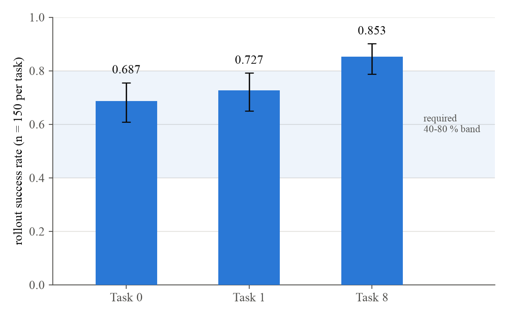

**Figure 5.1:** Rollout success rate per task with Wilson 95 % intervals and the required 40–80 % band. Redrawn from the counts in Table 5.1. Evidence file: `docs/figures/libero_success_rates.png`.

The band matters for a reason that is specific to this method: below it there is too little nominal behaviour to calibrate on, and above it too few failures to detect. Task 8 is outside the band at 0.853, so its failure count (22) limits how precisely its detection rate can be estimated; this is one reason the replication unit is the task and the claims below are phrased accordingly.

## 5.3 PRE-REGISTERED VERIFICATION CHECKS

Before the large collection, six checks (A1–A6) tested whether the design's assumptions hold on real policy rollouts. They were run on the first 20 task-0 rollouts (11 successes, 9 failures; `docs/verification-report.md`, `data/results/verification_task0.json`). Each failed criterion is listed with what it taught and what was changed.

**Table 5.2: Verification checks A1–A6**

| Check | Question | Result | Consequence |
|---|---|---|---|
| A1 | Do phase labels survive real rollouts? | No rollout gave exactly 8 segments (modal 9); but 0 rollouts had an empty phase, and regrasps averaged 2.36 (success) vs 3.67 (failure) | The criterion's premise was wrong: human demonstrations average 9.5 segments, so 8 was never attainable. Phase labelling is kept and regrasp count is noted as an unused feature. |
| A2 | Does the phase maximum separate success from failure? | Best phase AUC 0.88 (reach); grasp 0.43, transport 0.63, release 0.56 | The maximum is noisy. The 95th percentile gave reach AUC 1.00 and whole-rollout AUC 1.00, but it is parked pending replication on data not used to select it. |
| A3 | Is pooling the first and second occurrence of each stage justified? | KS $p$ = 0.374 / 0.147 / 0.147 / 0.675 (reach / grasp / transport / release) | Met. $K = 4$ is kept. With about 11 pairs this is "no evidence against". |
| A4 | Is `err_norm` unstable at near-zero motion? | 15 of 80 phase maxima (18.8 %) came from steps below 2 % of the maximum command | Without a floor the check failed. A 2 % floor (0.001732 m) removes the unstable tail while discarding under 1 % of steps. |
| A5 | Is task 8 usable? | 41/50 = 0.820, 95 % CI [0.714, 0.926] at screening | Included. The 150-rollout rate is 0.853 (Table 5.1). |
| A6 | Can calibration and evaluation share initial states? | 20 distinct initial states, zero repeats | Disjointness holds by construction; the split is assigned by a seeded generator at load time. |

A2 and A4 are connected: the spurious maxima of A4 explain much of A2's weak separation by the maximum. The choice of aggregation statistic is a design decision with consequences. `max` is the only statistic trusted in the current results, and coverage computed for any other statistic must use that same statistic for the coverage event.

## 5.4 CALIBRATED THRESHOLDS

**Table 5.3: Calibration artefacts at $\alpha = 0.10$, $\alpha_{esc} = 0.30$, $\beta = 0.10$, seed-0 split** (`data/results/demo_task{0,1,8}.json`; all phase thresholds feasible)

| Task | Phase | $q$ (safety) | $q_{esc}$ (escalation) | $d$ (dwell limit, steps) |
|---|---|---|---|---|
| 0 ($n_{cal}$ = 82) | reach | 1.230 | 1.139 | 128 |
| | grasp | 1.321 | 1.185 | 10 |
| | transport | 1.072 | 1.037 | 80 |
| | release | 1.922 | 1.457 | 10 |
| 1 ($n_{cal}$ = 81) | reach | 1.034 | 0.999 | 100 |
| | grasp | 1.392 | 1.258 | 10 |
| | transport | 1.290 | 1.102 | 71 |
| | release | 1.225 | 1.132 | 10 |
| 8 ($n_{cal}$ = 83) | reach | 1.147 | 1.110 | 130 |
| | grasp | 1.203 | 1.116 | 10 |
| | transport | 1.999 | 1.293 | 97 |
| | release | 1.168 | 1.103 | 10 |

Three observations follow. First, the four thresholds differ within a task by up to 1.8 times (task 0: 1.072 to 1.922) and the pattern differs between tasks, which is the evidence that a single threshold cannot suit every phase. Second, $q_{esc} < q$ in every cell, the property the arbiter relies on. Third, the grasp and release dwell limits are the structural 10 steps (Section 3.3), so those two cannot trigger a stall.

The per-task flat threshold (one threshold for the whole episode, $K = 1$) on the same seed-0 splits is 1.415, 1.261 and 1.287 for tasks 0, 1 and 8. In rollout 83 of task 0 the per-phase monitor flags a violation at step 40 (transport, $s = 1.092 > 1.072$), while the flat threshold of 1.415 never fires on that rollout (Section 5.8).

## 5.5 CALIBRATION EFFICIENCY: STAGE-AWARE VERSUS FLAT

Efficiency is measured by how tight the threshold band is while both arms stay at target coverage. The first assessment, at the default calibration fraction of 0.5 on task 0 only, showed the stage-aware arm wider than the flat arm (1.517 against 1.410). The diagnosis was sample size: with $n_{cal} = 52 < 79$, every phase threshold was the sample maximum, so the stage-aware arm paid the Bonferroni penalty without receiving the efficiency benefit (the second feasibility bound of Section 3.4). This is why `cal_frac` is now pre-registered per task as the smallest value clearing $n \ge 79$ per phase.

**Table 5.4: Threshold band, flat versus stage-aware, at the pre-registered calibration fractions** (`docs/status.md` §6.1; both arms at coverage 0.89–0.92 against a 0.90 target, 100 % feasibility)

| Task | $n_{cal}$ | Flat band | Stage-aware band | Ratio (stage-aware / flat) |
|---|---|---|---|---|
| 0 | 82 | 1.376 | 1.362 | 0.990 |
| 1 | 81 | 1.270 | 1.133 | 0.892 |
| 8 | 83 | 1.334 | 1.234 | 0.926 |

The stage-aware band is tighter on all three tasks, by 1.0 %, 10.8 % and 7.4 %. The "band" is the scalar summary reported in the project status document; its aggregation across phases and splits is defined in the project's `scp` calibration package, which is not part of this repository, so the ratio rather than the absolute value is the quantity to read.

A natural objection is that longer phase windows inflate the maximum simply by offering more draws. This was tested directly and refuted: the ordering of phase durations is identical across the three tasks while the ordering of thresholds differs in all three, and the correlation between duration and threshold is negative throughout (Pearson −0.30, −0.93, −0.42), the opposite sign to the hypothesis.

## 5.6 DETECTION AT MATCHED FALSE-ALARM RATE

The comparison that matters is detection at the same false-alarm cost. Comparing at the same nominal $\alpha$ is invalid because the Bonferroni split makes the stage-aware arm conservative, so the arms land at different achieved FAR; in the ablation, at $\alpha = 0.10$ the stage-aware arm had FAR 0.152 and the global arm 0.207, and the naive comparison reversed the conclusion by up to −0.27 TPR. Both arms are therefore compared at matched achieved FAR, and achieved FAR was confirmed to track nominal $\alpha$ for both arms.

**Table 5.5: Detection gain $\Delta$TPR (stage-aware minus flat) at matched achieved FAR** (`docs/status.md` §6.2; pre-registered `cal_frac`; positive means the stage-aware monitor catches more failures at the same false-alarm rate)

| Achieved FAR | Task 0 | Task 1 | Task 8 | Mean |
|---|---|---|---|---|
| 0.05 | +0.042 | +0.093 | +0.068 | +0.068 |
| 0.10 | +0.044 | +0.112 | +0.129 | +0.095 |
| 0.15 | +0.018 | +0.059 | +0.056 | +0.044 |
| 0.20 | −0.030 | +0.093 | −0.029 | +0.012 |
| 0.25 | −0.029 | +0.089 | −0.017 | +0.014 |

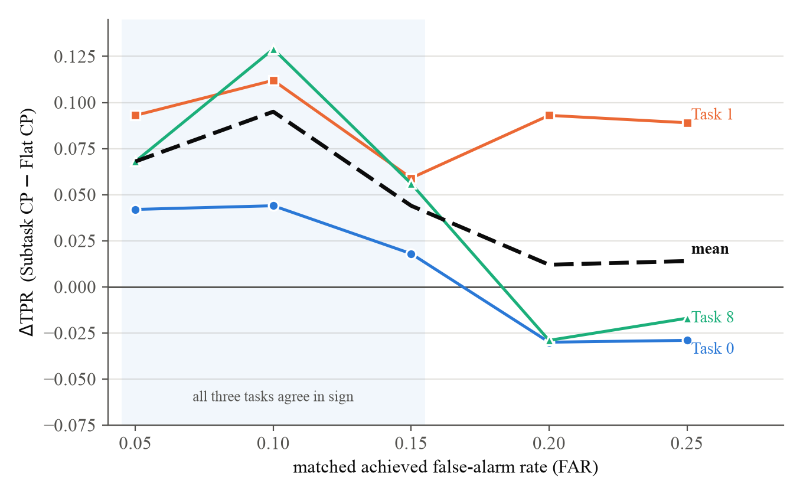

**Figure 5.2:** Detection gain $\Delta$TPR at matched achieved FAR for each task and the mean. The shaded region marks the false-alarm range over which all three tasks agree in sign. Redrawn from Table 5.5. Evidence file: `docs/figures/libero_matched_far_gain.png`.

**Reading the table.** All three tasks agree in sign at FAR up to 0.15, with the gain peaking at 0.10 (mean +0.095). At FAR of 0.20 and above the tasks disagree: task 1 stays positive, while tasks 0 and 8 go slightly negative, with only 25–35 % of paired draws favouring the stage-aware arm. The supported claim is therefore an advantage in the window FAR ≤ 0.15, not an advantage everywhere. The window is also bounded below: with four phases at $\alpha/4$, the stage-aware arm cannot operate below an achieved FAR of about 0.04–0.05 on any task (the Bonferroni floor $4/(n_{cal}+1) \approx 0.048$), while the flat arm stays feasible down to 0.005–0.017.

**A second implementation.** An earlier ablation script (`scripts/ablation_global.py`, results in `docs/ablation-result.md`) computed the same comparison with a different implementation and found larger gains that rise with FAR.

**Table 5.6: Detection gain from the earlier ablation implementation** (`docs/ablation-result.md`; 20 seeds per point, paired within seed)

| Achieved FAR | Task 0 | Task 1 | Task 8 | Mean |
|---|---|---|---|---|
| 0.05 | +0.073 | +0.022 | −0.021 | +0.025 |
| 0.10 | +0.132 | +0.034 | +0.012 | +0.059 |
| 0.15 | +0.086 | +0.060 | +0.067 | +0.071 |
| 0.20 | +0.075 | +0.128 | +0.138 | +0.114 |
| 0.25 | +0.070 | +0.230 | +0.153 | +0.151 |
| 0.30 | +0.077 | +0.215 | +0.125 | +0.139 |

The two implementations agree that the stage-aware monitor detects more failures at FAR 0.15 on all three tasks, and they differ in magnitude (+0.044 against +0.071 at FAR 0.15) and in shape at higher FAR. The pre-registered analysis of Table 5.5 is the more trustworthy of the two, because it uses the per-task `cal_frac` fixed before the results were seen. The difference between the two implementations has not yet been diffed line by line and is the first item of future work (Conclusion and Future Work); neither number should be quoted as final until it is resolved. The Review 3 presentation quoted the headline mean of +0.071 at FAR 0.15, which comes from the earlier implementation; the pre-registered value is +0.044.

**Single-split artefact outcomes.** The calibration artefacts of Table 5.3 also record outcomes on their one seed-0 split, which the viewer displays.

**Table 5.7: Outcomes recorded in the per-task artefacts** (`data/results/demo_task{0,1,8}.json`; single split, not a distribution; the repeated-split results are Tables 5.4–5.5)

| Task | FAR | Detection rate | Median lead (steps) |
|---|---|---|---|
| 0 | 0.190 | 0.447 | 431 |
| 1 | 0.107 | 0.122 | 460 |
| 8 | 0.067 | 0.455 | 265 |

Lead times are measured to the end of the episode. Every failure in the dataset runs to the 600-step cap, so lead time and any duration-based detection are inflated by that cap and are reported as such.

## 5.7 WHAT REPLICATED FROM THE SYNTHETIC PREDICTIONS

Validation on simulated scores preceded the real-data study, and four of its predictions were confirmed:

1. **Coverage validity.** Both arms land near the 0.90 target on all three tasks (0.89–0.92).
2. **The $n \ge 39$ feasibility bound.** Confirmed exactly: vacuous below, feasible at and above it.
3. **Single-split variance.** The real spread of coverage over splits (about 82–97 % at calibration sizes near 40) matches the synthetic prediction, which is why coverage is always reported as a distribution over splits.
4. **Detection earliness.** The stage-aware monitor flags consistently earlier than the flat monitor at matched coverage.

## 5.8 THE MONITOR IN ACTION

The viewer replays a recorded rollout through the same monitor code used for evaluation. Figure 5.3 shows a held-out success and Figure 5.4 a failure from task 0, both from `data/results/*.mp4` (frames extracted at the stated steps).

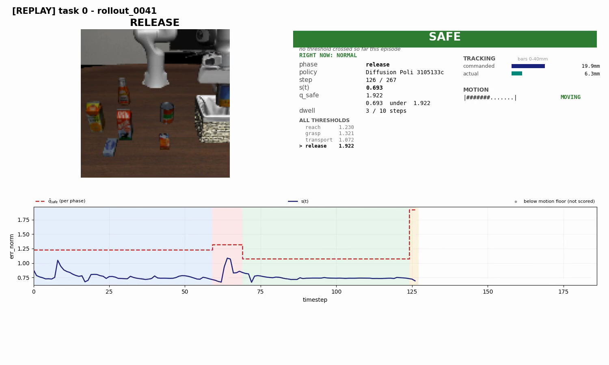

**Figure 5.3:** Rollout 41 of task 0 at step 126 of 267, in the release phase. The verdict is SAFE, $s(t) = 0.693$ against $q = 1.922$ for release, and the score stays under the red per-phase threshold throughout the episode. Evidence file: `docs/figures/libero_monitor_success_r41.png` (frame 130 of `data/results/demo_r41.mp4`).

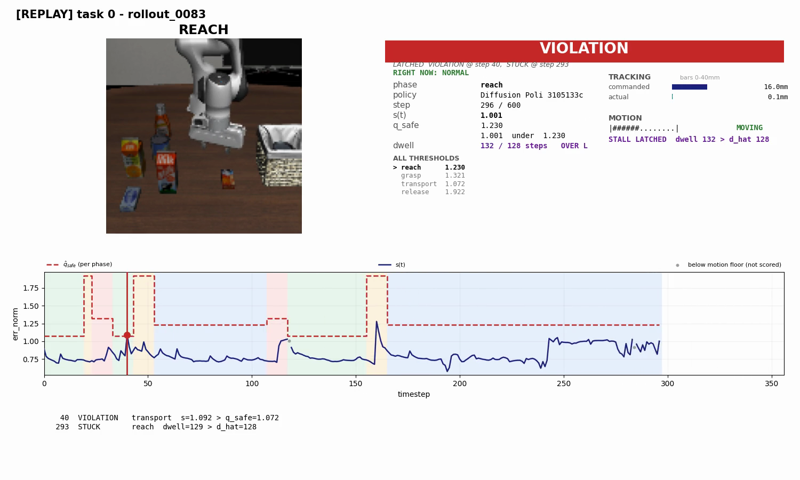

**Figure 5.4:** Rollout 83 of task 0 at step 296 of 600, in the reach phase. A VIOLATION was latched at step 40 (transport, $s = 1.092 > q = 1.072$), 560 steps before the episode's end, and a STUCK verdict was latched at step 293 (reach dwell 129 > $d$ = 128). The red marker on the lower axis is the violation. Evidence file: `docs/figures/libero_monitor_violation_r83.png` (frame 300 of `data/results/demo_r83.mp4`).

A third recorded case, rollout 76, is the stall case: the gripper never closes in 600 steps, so only the reach phase occurs and the dwell detector fires at step 128. On rollout 83 the flat threshold of 1.415 does not fire at all, which is the situation the per-phase thresholds are designed for: a deviation that is large relative to the transport phase's calibrated envelope but small against a single envelope that must also accommodate the release phase.

## 5.9 METHODOLOGY FINDINGS

Four defects were found and fixed during the study. They are reported because each changed how results must be read.

1. **Coverage was evaluated against the wrong event for non-max statistics.** Coverage was computed as "no timestep exceeds $q$" regardless of which aggregation statistic calibrated $q$, which is correct only for `max`. This produced impossible results for other statistics (coverage 0.000 with detection 1.000). The coverage event now uses the calibration statistic. Results for `max` were unaffected, and results for other statistics computed before the fix are invalid.
2. **Alarms were evaluated over steps calibration had masked.** After the fix described in Section 4.4, task-0 FAR moved from 0.238 to 0.190 and detection from 0.617 to 0.447 with the thresholds unchanged.
3. **A noise-injection bug was caught before any collection used it.** For planned wave-2 collection, the planned position was computed from the clean action while the controller received the noised one, so the score would partly have measured injected noise as tracking error. The fix (both the planned position and the command norm derive from the executed action, and the gripper channel is excluded from noise) is applied but not yet probe-verified, and wave-2 collection is paused.
4. **Empty-phase rollouts.** Three task-0 rollouts lack a phase: rollout 36 starts closed and never re-closes (no grasp), rollout 75 has no closed interval over 10 steps (no transport) and rollout 76 never closes (reach only). All three are failures, so calibration is unaffected. Rollout 75 lies in the evaluation split and has an undefined transport maximum: a reduction that propagates the undefined value would silently turn a detected failure into a miss, worth at most 1/47 ≈ 0.021 on task 0's detection rate in the direction of understating it, so the evaluation must reduce with a nan-aware maximum or alarm per timestep against the phase label.

---

# CHAPTER 6: EXPERIMENTS AND RESULTS: ARBITRATION AND COMPUTE

This chapter reports four studies that exercise the arbitration idea and its cost. They use different tasks, scores, policies and hardware, so each is reported on its own and none is pooled with another or with Chapter 5. Section 6.1 and 6.2 describe the native MuJoCo reach-then-push system, which is the closed-loop arbitration experiment; Section 6.3 the earlier panda-gym composition studies; Section 6.4 the compute-efficiency benchmark; and Section 6.5 an auxiliary closed-loop study.

## 6.1 NATIVE MUJOCO REACH-THEN-PUSH: CONTROLLER AND POLICIES

### CONTROLLER TUNING

A 0.05 m end-effector command initially completed only 0.208 of its displacement inside the 0.04 s control period, with three actuators pinned at their force limits on the first substep. Scaling the action did nothing, since the servo was already at its torque ceiling. The acceptance target was not 1.0 but 0.655, because the reference system's own controller delivers a median achieved/commanded ratio of 0.655 for the expert (0.597 for the cheap policy) from recorded episodes, and matching a better tracker would create a different mismatch. A sweep of 60 configurations over stiffness, damping ratio and force limit selected `kp × 1`, `kv/kp = 0.035` and `forcerange × 10`. The fix was damping, not stiffness: the default damping ratio of 0.10 over-damps the servo, so time to 90 % was 109 substeps (0.22 s) against a 20-substep control period.

**Table 6.1: Controller before and after tuning** (`handout_mujoco/results/controller_tuning.md`)

| Quantity | Baseline | Selected | Reference system |
|---|---|---|---|
| Achieved / commanded displacement | 0.300 | 0.645 | 0.655 |
| End-effector error at step 2 (m) | 0.0836 | 0.0341 | n/a |
| End-effector error at step 10 (m) | 0.1044 | 0.0641 | n/a |
| End-effector error at end (m) | 0.1207 | 0.0906 | n/a |
| Saturated actuators | 3 | 0 | n/a |
| Time to 90 % (substeps) | 109 | 26.5 | n/a |

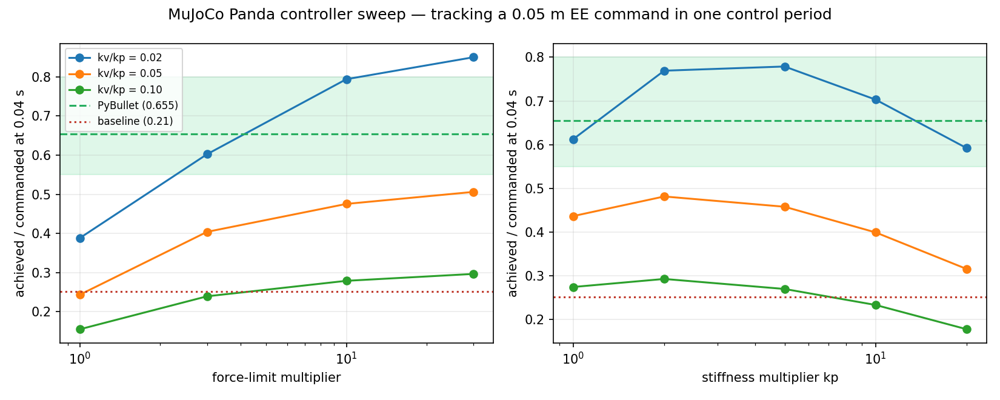

**Figure 6.1:** The controller sweep over force-limit multiplier (left) and stiffness multiplier (right) for three damping ratios. The dashed line is the reference system's 0.655, the shaded band the acceptance region and the dotted line the untuned baseline (0.21 on the unit-vector probe). Evidence file: `docs/figures/controller_tuning.png`.

**What tuning does not fix.** Open-loop replay of recorded expert actions still failed in MuJoCo (0 of 8, against 6 of 8 for the same seeds in the reference system), because the two engines' contact models diverge once the gripper touches the cube, and the cube ended 0.24 m from where the reference left it. The controller was a real defect and is fixed, but contact physics dominates the remaining difference. Open-loop replay is the worst case, since it has no feedback; whether policies work in MuJoCo is settled by running them closed-loop, which is what the experiments below do. A caveat on physical realism also applies: `forcerange × 10` puts joint torques well above a real Panda's 87 N·m, deliberately, to match the reference system's near-kinematic position control. This is the right trade for sim-to-sim comparison and the wrong one for sim-to-real.

### THE POLICIES

**Table 6.2: Policies on the MuJoCo track** (`results/mujoco_train/`; evaluation seeds 400,000–400,199, n = 200 unless stated)

| Policy | Description | Success (Wilson 95 %) | Source file |
|---|---|---|---|
| Reach | scripted proportional servo | 1.000 reach success, median 4 steps | `ARBITRATION_REPORT.md` |
| Push expert, final model | TQC + HER, 300,000 steps, 541,190-parameter actor (2,751,082 including critics), 7,991 s at 37.5 steps/s | 0.930 [0.895, 0.965] (push alone) | `push_expert/seed0/push_eval.json` |
| Push expert, best checkpoint | same run, checkpoint chosen during training | 0.950 [0.910, 0.973] (push alone) | `push_difficulty_breakdown.md` |
| Expert pair (servo + push) | composed | 0.925 [0.880, 0.954] | `arbitration_eval.json` |
| Cheap policy | 26→16→16→3 MLP, 755 parameters, distilled from the composed expert | 0.680 [0.612, 0.741] | `arbitration_eval.json` |

Two caveats travel with these numbers. The push expert's 0.930 was measured on starts drawn from a distribution fitted to a proportional servo, so it is conditional on that hand-off and is never quoted as a composed-success prediction; the composed measurement is 0.925. And one training seed exists: two further seeds were stopped mid-run (60,000 of 300,000 steps) and would have to be restarted, since the replay buffer is not checkpointed. For the final model the cube leaves the table in 3.5 % of episodes, concentrated in the third difficulty quartile (8 % of that quartile for the best checkpoint, Table 6.3 source).

**Table 6.3: Push expert success by initial cube-to-goal distance** (`push_difficulty_breakdown.md`; best checkpoint; 50 episodes per quartile)

| Quartile | Distance range (m) | Success | Wilson 95 % | Mean length |
|---|---|---|---|---|
| Q1 | 0.051–0.113 | 1.000 | [0.929, 1.000] | 4.9 |
| Q2 | 0.113–0.156 | 1.000 | [0.929, 1.000] | 5.8 |
| Q3 | 0.156–0.214 | 0.900 | [0.786, 0.957] | 8.8 |
| Q4 | 0.214–0.398 | 0.900 | [0.786, 0.957] | 14.5 |

The median split at 0.156 m defines two regimes by reset geometry alone, with no outcome entering the split: EASY (success 1.000, n = 100) and HARD (0.900, n = 100). The 10-point gap is modest, and it is the shift against which budget compliance is tested in Section 6.2.

## 6.2 NATIVE MUJOCO REACH-THEN-PUSH: ARBITRATION RESULTS

### WHICH SCORE TO TRIGGER ON

Four candidate scores were compared on how well they foresee a push failure at decision time, selected on seeds 300,000–300,499 and reported on 300,500–300,999. The score used in the LIBERO study (the compliance residual) was one candidate.

**Table 6.4: Score informativeness for the push phase (AUC, held-out half)** (`ARBITRATION_REPORT.md`)

| Candidate | Horizon 2 | Horizon 4 | Horizon 8 | All steps |
|---|---|---|---|---|
| (a) compliance residual | 0.658 | 0.602 | 0.610 | 0.898 |
| (b) ensemble disagreement | 0.628 | 0.701 | 0.813 | 0.924 |
| (c) predicted action standard deviation | 0.580 | 0.567 | 0.668 | 0.853 |
| (d) distance between end effector and cube | 0.574 | 0.543 | 0.575 | 0.802 |

The compliance residual looks strong in hindsight (0.898 over all steps) but falls below the 0.65 gate at decision time (0.610 at horizon 8), whereas ensemble disagreement reaches 0.813. Ensemble disagreement was therefore selected for this track. The finding is specific to this task and policy pair and does not alter the LIBERO score, where the compliance residual is the pre-registered choice.

### CALIBRATION

1,000 calibration episodes (seeds 300,000–300,999) gave 685 successful episodes used for calibration, with $K = 2$ phases (reach and push), $\alpha = 0.10$ and $\alpha_k = 0.05$ (rank 652 of 685).

**Table 6.5: Thresholds for the ensemble-disagreement score** (`calibration.md`)

| Phase | $q$ (safety) | $q_{esc}$ at $\alpha_{esc}$ = 0.20 | 0.30 | 0.40 |
|---|---|---|---|---|
| Reach | 0.1235 | 0.0829 | 0.0750 | 0.0686 |
| Push | 0.1966 | 0.1447 | 0.1254 | 0.1150 |

$q_{esc} < q$ holds in every phase at every budget, the leading-indicator property the arbiter depends on. The quantity bounded is the spurious-escalation rate on nominal episodes, not a safety guarantee for an arbitrated trajectory.

### BUDGET COMPLIANCE UNDER DISTRIBUTION SHIFT

The claim tested here is the calibration claim. When the reset distribution shifts from EASY to HARD, a fixed threshold tuned on the easy regime fires far more often than its budget, whereas a conformal threshold recalibrated on unlabelled scores from the new regime keeps the firing rate near the budget. Regimes are split on reset geometry only (median $d_0 = 0.1581$ m); the test regime is HARD with 92 episodes and 60 calibration draws.

**Table 6.6: Realised escalation rate on HARD episodes** (`results/mujoco_train/shift_rate_control.json`)

| Target budget | Fixed threshold (tuned on EASY) | Conformal (recalibrated on HARD) | Conformal carried over from EASY | Random at matched rate |
|---|---|---|---|---|
| 0.20 | 0.775 ± 0.015 | 0.273 ± 0.018 | 0.775 ± 0.015 | 0.266 ± 0.052 |
| 0.30 | 0.816 ± 0.010 | 0.347 ± 0.021 | 0.816 ± 0.010 | 0.342 ± 0.045 |
| 0.40 | 0.886 ± 0.021 | 0.423 ± 0.016 | 0.886 ± 0.021 | 0.424 ± 0.062 |

The mean absolute deviation of the conformal threshold from the budget is 4.7 percentage points (gate: below 5 pp, passed) against 52.5 for the fixed threshold (gate: above 15 pp, passed). The sampling floor at 92 test episodes is 3.7 pp, so the conformal result is close to the limit the test-set size allows. A control identity isolates what is being claimed: the conformal threshold carried over from EASY is bit-identical to the fixed threshold, so the advantage comes from recalibration being possible on unlabelled scores and not from conformal prediction being intrinsically better.

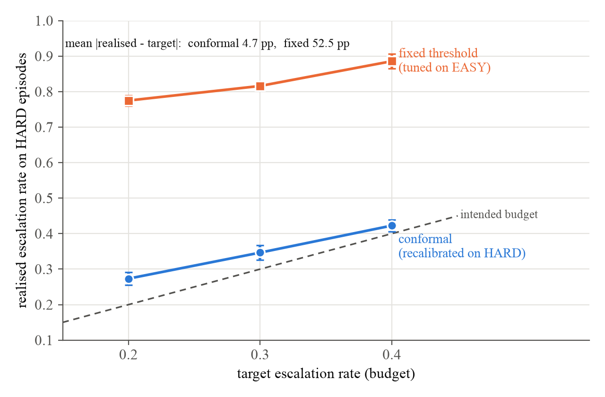

**Figure 6.2:** Realised escalation rate on HARD episodes against the target budget, for a fixed threshold tuned on EASY and a conformal threshold recalibrated on HARD; error bars are one standard deviation over 60 calibration draws. Redrawn from Table 6.6. Evidence file: `docs/figures/mujoco_budget_compliance.png`.

**This is budget compliance, not success.** The drifted fixed threshold fires on 77–89 % of episodes against a 20–40 % budget; it will often score higher on success precisely because it spends compute it was not authorised to spend.

**Exclusion variant.** To test whether the trigger merely reads the regime from the goal columns of the observation, those columns were masked. The regime remained partly recoverable (the held-out MLP probe's $R^2$ for $d_0$ fell from 0.998 to 0.395), so the exclusion is partial. A linear probe was tried first and reported about zero for both, because it cannot represent a norm, and it therefore proved nothing. With the masked trigger the conformal threshold deviates by 2.8 pp and the fixed one by 47.9 pp, and both gates still pass.

### PAIRED EVALUATION

Eight arms were run on the same 200 held-out seeds (400,000–400,199), with every policy timed batch-1 on CPU.

**Table 6.7: Paired evaluation** (`ARBITRATION_REPORT.md`, `arbitration_eval.json`)

| Arm | Success (Wilson 95 %) | Reach | Mean length | Expert calls / episode | Expert steps (%) | Switches | First escalation (median step) | ms per step |
|---|---|---|---|---|---|---|---|---|
| Expert only | 0.925 [0.880, 0.954] | 1.000 | 14.1 | n/a* | 100* | n/a* | n/a | 0.446 |
| Cheap only | 0.680 [0.612, 0.741] | 0.995 | 22.8 | 0.00 | 0.0 | 0.00 | n/a | 0.420 |
| Arbitrated, $\alpha_{esc}$ 0.20 | 0.820 [0.761, 0.867] | 1.000 | 16.6 | 0.61 | 30.0 | 0.74 | 6 | 0.494 |
| Random, 0.20 | 0.815 [0.755, 0.863] | 0.995 | 18.6 | 0.39 | 12.8 | 0.45 | 21 | 0.581 |
| Arbitrated, 0.30 | 0.850 [0.794, 0.893] | 1.000 | 15.8 | 0.70 | 37.6 | 0.78 | 6 | 0.500 |
| Random, 0.30 | 0.895 [0.845, 0.930] | 1.000 | 13.8 | 1.00 | 49.6 | 1.06 | 6 | 0.508 |
| Arbitrated, 0.40 | 0.885 [0.833, 0.922] | 1.000 | 14.4 | 0.76 | 42.0 | 0.82 | 6 | 0.530 |
| Random, 0.40 | 0.895 [0.845, 0.930] | 1.000 | 13.8 | 1.00 | 50.0 | 1.04 | 6 | 0.514 |

*The expert-only arm has no arbiter, so the arbiter counters are not applicable to it; the source table lists 0.00 and 0.0 in these cells and the expert acts on every step by construction.

Define the gain recovered as (arbitrated − cheap) / (expert − cheap). It is 0.571 at $\alpha_{esc} = 0.20$, 0.694 at 0.30 and 0.837 at 0.40: arbitration recovers 57 to 84 per cent of the gap between the cheap and expert policies while the expert acts on 30 to 42 per cent of steps.

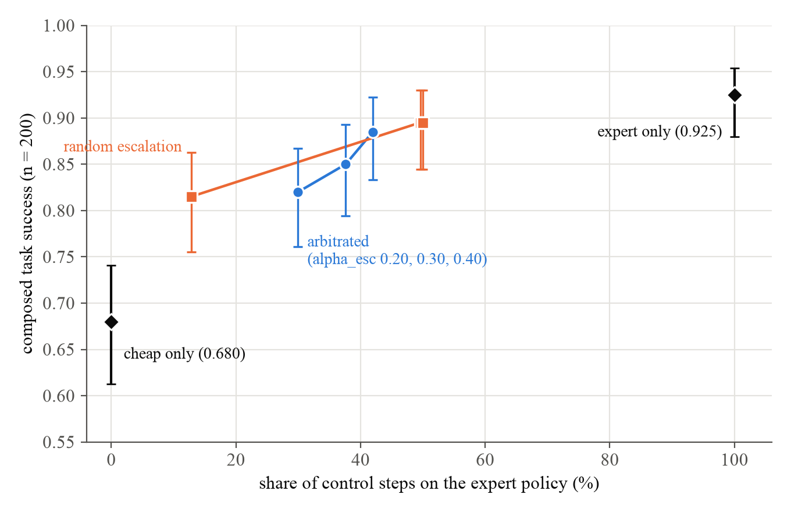

**Figure 6.3:** Composed task success against the share of control steps run on the expert, with Wilson 95 % intervals, for the cheap-only and expert-only policies, the arbitrated policy at three escalation budgets and the random-escalation control. Redrawn from Table 6.7. Evidence file: `docs/figures/mujoco_arbitration_frontier.png`.

### THE CALIBRATED TRIGGER COMPARED WITH RANDOM ESCALATION

**Table 6.8: Arbitrated versus random escalation, paired on the same seeds** (`arbitration_eval.json`)

| $\alpha_{esc}$ | Arbitrated | Random | Difference | Discordant pairs (arbitrated-only / random-only) | McNemar $p$ (McNemar, 1947) |
|---|---|---|---|---|---|
| 0.20 | 0.820 | 0.815 | +0.005 | 19 / 18 | 1.000 |
| 0.30 | 0.850 | 0.895 | −0.045 | 12 / 21 | 0.163 |
| 0.40 | 0.885 | 0.895 | −0.010 | 13 / 15 | 0.851 |

At matched expert usage the calibrated trigger is not distinguishable from random escalation: no comparison approaches significance. At $\alpha_{esc} = 0.20$, random escalation reaches the same success (0.815 against 0.820) using 12.8 % expert steps against the arbiter's 30.0 %. This holds despite a score with AUC 0.813 at decision time, and the reason is that a high AUC is necessary but not sufficient. The value of escalating depends on whether the expert's rescue probability varies with *when* it is called, and here it does not, because the push expert rescues from almost anywhere. The random control could not be matched exactly on expert-step share: a memoryless Bernoulli trigger plus the 8-step hand-back reaches a coarse set of operating points (12.8 % and about 50 % with nothing between, since one early escalation captures most of a roughly 15-step episode). The control is therefore bracketed, not exactly matched.

What the results do support is stated in the project's claims file: closed-loop calibrated arbitration runs correctly with live switching; arbitration clearly improves on the cheap policy at low expert cost; and the escalation budget transfers across a distribution shift when recalibrated on unlabelled scores. The results do not support a claim that calibrated timing beats random timing at equal cost, and they do not support calling any arbitrated run safe.

### THE LIVE DEMONSTRATION

The live arena (`handout_mujoco/live/arena_reach_push.py`) renders three camera views, a cube path, the score against both thresholds, the arbitration state and the policy stack, with every observation produced by MuJoCo physics at every step and nothing replayed. Three evaluation seeds are cases where the cheap policy fails and the arbitrated run succeeds: 400016 (first escalation at step 10, expert on 47 % of steps), 400167 (step 10, 61 %) and 400169 (step 6 in the reach phase, 71 %), each with one expert call. On the visual claim, accuracy matters: $q_{esc} < q$ in every phase, so escalation always fires at the lower line first, but it does not follow that the trajectory stays under $q$ afterwards. Measured on the three seeds, the score stays below $q$ on 400016 and 400167 and crosses it twice on 400169 (maximum 1.55 times $q$), so the demonstration should not be narrated as "the trajectory never reaches the red line".

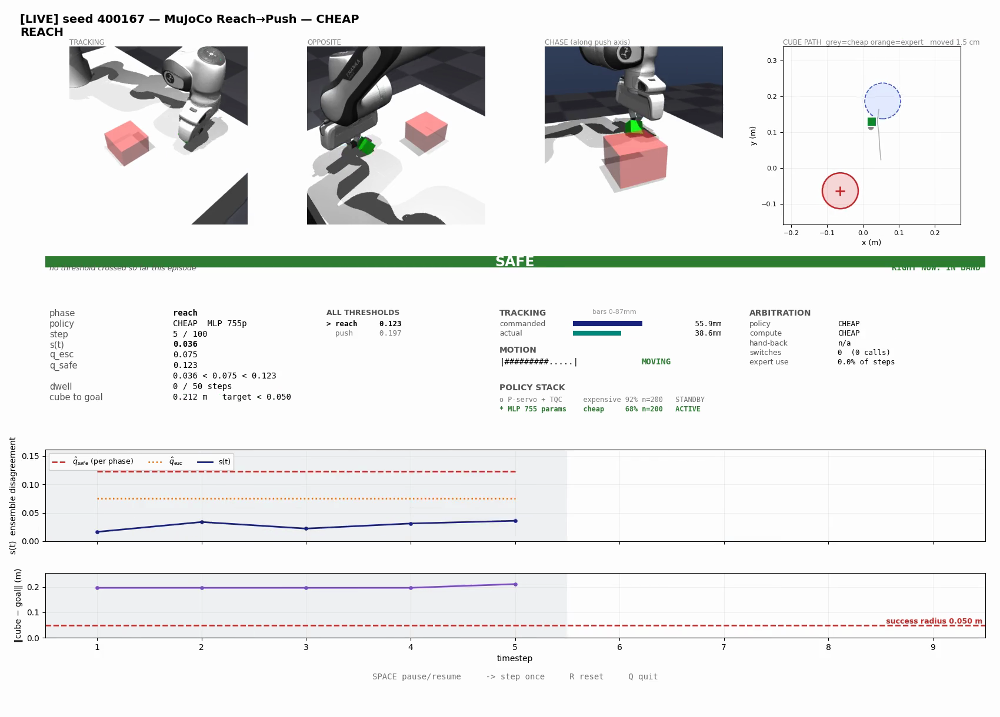

**Figure 6.4:** Seed 400167, step 5 of 100, reach phase. The cheap 755-parameter policy is active, the verdict is SAFE, and the score 0.036 sits below $q_{esc}$ = 0.075 and $q$ = 0.123. Arbitration state: 0 switches, 0.0 % of steps on the expert. Evidence file: `docs/figures/mujoco_arena_cheap_seed400167.png` (frame 60 of `handout_mujoco/results/mujoco_train/arena_reach_push.mp4`).

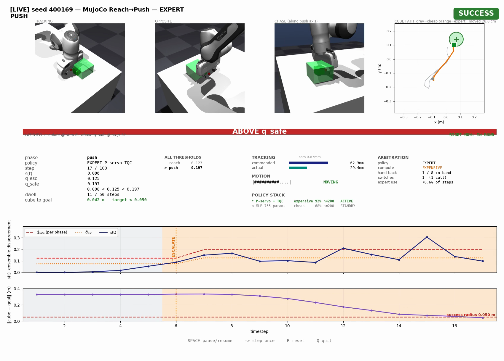

**Figure 6.5:** Seed 400169, step 17 of 100, push phase, episode marked SUCCESS. The log reads "escalate at step 6, above $q$ at step 12". The expert is active (hand-back counter 1 of 8, one call, 70.6 % of steps on the expert), and the cube is 0.042 m from the goal, inside the 0.050 m success radius. Evidence file: `docs/figures/mujoco_arena_expert_seed400169.png` (frame 178 of the same video).

## 6.3 THE PANDA-GYM COMPOSITION STUDIES

Before the native MuJoCo system, arbitration was studied in panda-gym (PyBullet) on composed tasks, with pre-registered gates deciding whether a task is a suitable testbed. The studies are a separate track, not pooled with anything else, and they are reported here because they explain why the reach-then-push composition was chosen and what the earlier system showed.

**Sub-skill verification.** Fifty episodes per checkpoint in the sparse environment, with a success bar of 0.80. Reach checkpoints reached 50 of 50 (selected: `chencliu/tqc-PandaReach-v3`) and the Slide checkpoint 48 of 50 = 0.96 (selected). The best Push checkpoint measured 0.76 on 50 episodes and 0.715 on 200 fresh seeds, below the bar; other Push checkpoints were non-functional (2 of 50, successes only when the object already started inside the goal threshold). The bar was not lowered. A reward number can mislead: one checkpoint with a usable-looking reward measured 2 of 50.

**Fine-tuning the Push expert.** The rejected checkpoint had trained for 125,000 steps against a reference recipe of 1,000,000. Continuing training with hindsight experience replay (after a first attempt with the checkpoint's own settings and an empty replay buffer collapsed from 0.78 to 0.18 within 3,000 steps) reached 0.90 at 350,000 steps. Selected on seeds 170,000–170,099, it was then verified on 200 fresh seeds (200,000–200,199): 180 of 200 = 0.90 (Wilson [0.85, 0.93]), against 0.685 for the original checkpoint on the same seeds (51 fine-tuned-only successes against 8, exact McNemar $p = 9 \times 10^{-9}$).

**Composition.** Reach then Slide gave a composed success of 0.865 (173 of 200), below the product of sub-skill rates (0.96) because of a measured boundary distribution shift in the Slide start pose (success 1.00, 0.89, 0.70 across terciles of the distance of the reach end-pose from Slide's home pose). Reach then Push gave 0.89 (178 of 200) against a product of 0.90, with no boundary shift detected (Push from its native start 0.895, 18 against 17 discordant, $p = 1.0$).

**Table 6.9: Composition checks** (`composed/results/REPORT_composed_longhorizon.md`, `handout_mujoco/results/REPORT_reach_push.md`)

| | Reach then Slide | Reach then Push |
|---|---|---|
| Composed success (n = 200) | 0.865 [0.81, 0.91] | 0.89 [0.84, 0.93] |
| Product of sub-skill rates | 0.96 | 0.90 |
| Failures by phase | reach 0 / slide 27 | reach 0 / push 22 |
| Median episode length | 16 | 12.5 |
| Object displaced by reach (max) | 0.26 mm | 0.02 mm |

**Rescue curves.** The suitability test asks how late the expert can take over and still rescue a failing cheap run: for 100 cheap-failure seeds the expert takes permanent control from step $t$ and the rescue rate $R(t)$ is measured. Reach then Slide is a cliff (0.79 at $t$ = 0, 0.35 at 10, 0.12 at 15), so the decision window is only 5–10 steps wide and sits at the very start of Slide. Reach then Push declines gradually (0.77, 0.68 at 10, 0.54 at 15, 0.39 at 30, 0.30 at 45), which is the graded window arbitration needs.

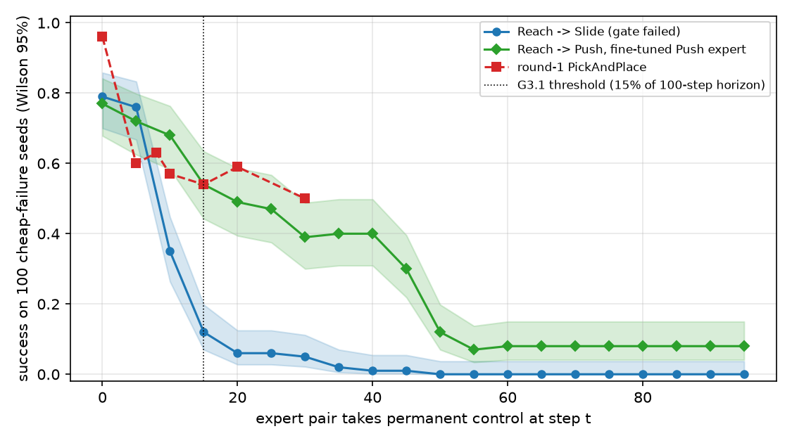

**Figure 6.6:** Rescue rate against the step at which the expert takes permanent control, for Reach then Slide (a cliff), Reach then Push (graded) and an earlier PickAndPlace round. The dotted line is the pre-registered horizon threshold. This figure was plotted from the run in which the simulator carried state across resets, which produced a residual 0.08 floor at late steps; after the determinism fix of Section 4.6 the floor disappears (rescue 0.00 at $t \ge 55$) and the Push curve keeps its graded shape. Evidence file: `docs/figures/rescue_curve.png`.

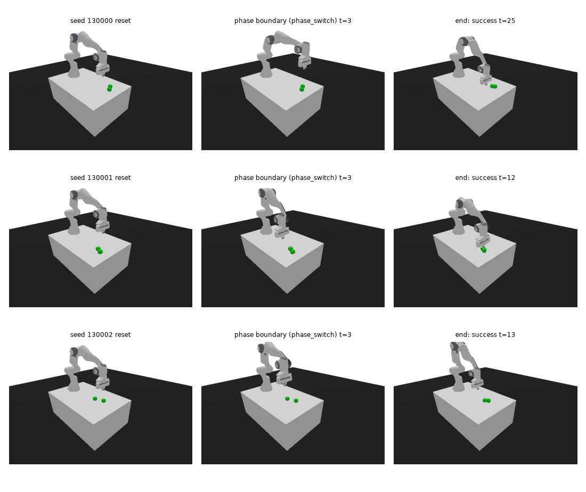

**Figure 6.7:** Three composed episodes (seeds 130,000–130,002) at reset, at the phase boundary (step 3) and at the end (success at steps 25, 12 and 13). The reach phase leaves the cube undisturbed at the boundary. Evidence file: `docs/figures/phase_boundary_frames.png`.

**Gates and an authorised override.** Two pre-registered gates were applied. The rescue-curve gate (G3.2) passed on all four checks. The horizon gate (G3.1, median irreversibility step above 15 of a 100-step horizon) missed at its boundary: the median was exactly 15.0 (interquartile range 20 after the determinism fix). Calibration and benchmark were run on explicit authorisation, with the override recorded in the result file (`part45_benchmark.json["gate_override"]`) and stated with any presentation. The statistic is also confounded: for 57 of 77 rescuable seeds in the shared-environment run (and 66 % of seeds after the determinism fix) a handover fails at some step and then succeeds at a later one, so "first grid step at which handover fails" records transient misses as irreversibility.

**Benchmark (500 paired seeds, $\alpha_{esc}$ = 0.30, deterministic resets).**

**Table 6.10: Four-way benchmark on the Reach-then-Push task** (`handout_mujoco/results/efficiency_summary.json`, `REPORT_reach_push.md`)

| Condition | Success (Wilson 95 %) | Expert steps (per-episode mean) | Expert calls per episode |
|---|---|---|---|
| Cheap alone | 0.436 [0.393, 0.480] | 0.0 % | 0 |
| Expert pair alone | 0.840 [0.805, 0.870] | 100 % | 19.7 |
| Arbitrated | 0.530 [0.486, 0.573] | 12.8 % | 2.9 |
| Random escalation, retuned | 0.504 [0.460, 0.548] | 10.9 % | 3.5 |

Arbitration improves on the cheap policy (+0.094, 95 % interval +0.066 to +0.124) with 2.9 expert calls per episode against 19.7, about 85 % fewer, and about 1.6 times the success gain per expert call (3.2 points per call against 2.1). It stays far below expert-only (−0.310). Against matched-cost random escalation the difference is +0.026 [−0.014, +0.066] ($p$ = 0.24) at $\alpha_{esc}$ = 0.30, and no comparison at 0.20, 0.30 or 0.40 excludes zero: the finding of Section 6.2 recurs on a task that has a genuine timing window.

The diagnostics suggest why. The trigger separates failures only weakly (AUC 0.68 for the maximum of $s/q_{esc}$ per phase); it fires very early, at a median step of 3 to 4 around the reach-to-push boundary, so it is reacting to the phase transition more than to push-phase trouble; and the hold-and-return rule hands control back after 8 quiet steps, whereas permanent control from step 10 to 15 rescues 54–68 % of cheap failures. With hold-and-return the arbiter rescues 18.8 % of them (random 15.2 %). The task finally has a timing window, but the trigger and the de-escalation rule do not exploit it. Efficiency here is a statement about expert-model invocations, not wall-clock: measured CPU inference is 0.08 ms (cheap), 0.32 ms (reach expert) and 0.41 ms (push expert) while the physics step takes about 1.3 ms.

**A replay for presentation.** `handout_mujoco/` also contains a kinematic replay of the recorded panda-gym episodes rendered in MuJoCo: joint angles and cube poses recorded in PyBullet are written into a MuJoCo scene frame by frame and MuJoCo only renders them. The policies do not run in MuJoCo for these videos, and they are labelled "replay of simulated runs".

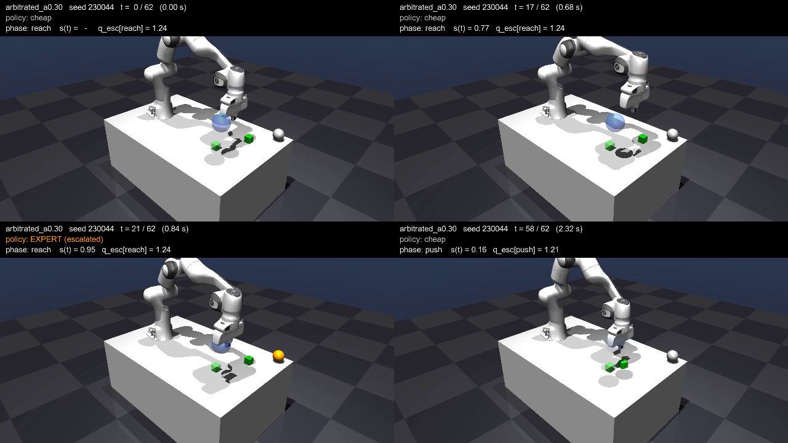

**Figure 6.8:** Four stills of the arbitrated episode of seed 230044 at $\alpha_{esc}$ = 0.30 (62 steps; the cheap policy alone fails on this seed). The overlay shows the cheap policy at steps 0 and 17, escalation to the expert at step 21 (score 0.95 against $q_{esc}$[reach] = 1.24, the lamp on the table turns orange) and the cheap policy again at step 58 in the push phase. The expert acts for 8 of the 62 steps. This is a replay of a panda-gym recording, not a native MuJoCo closed-loop run. Evidence file: `docs/figures/mujoco_replay_strip_seed230044.png`.

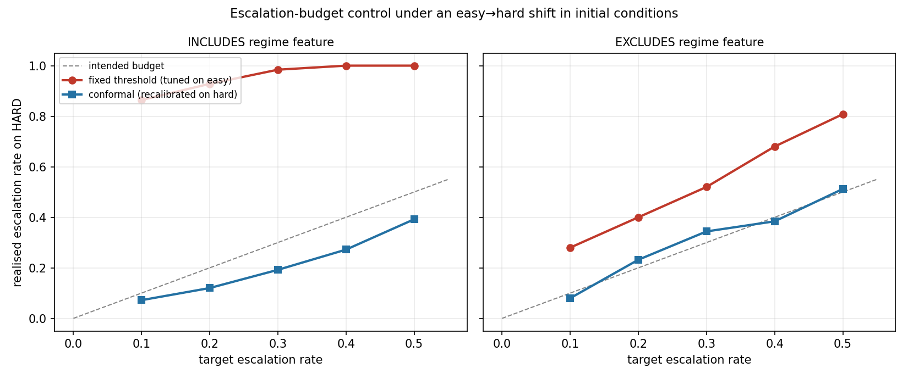

**Figure 6.9:** The same budget-compliance test as Section 6.2 in the earlier panda-gym system, with the regime feature included in the trigger (left) and excluded (right). A fixed threshold tuned on the easy regime drifts to a realised rate of about 0.86–1.0 (left) and 0.28–0.81 (right) against the intended budget, while the conformal threshold recalibrated on the hard regime stays at or below the budget on the left and near it on the right. This figure belongs to the panda-gym track (`handout_mujoco/results/shift_rate_control.json`), not to the MuJoCo-native experiment of Figure 6.2. Evidence file: `docs/figures/shift_rate_control.png`.

## 6.4 COMPUTE EFFICIENCY AND THE ROBOTURK TRACK

### THE BENCHMARK

The compute benchmark compares a cheap sequential policy (BC-RNN, 1,150,037 parameters, a 2-layer LSTM stepped one frame at a time) against an expensive chunked policy (ACT v2, 9,805,128 parameters, chunk 16, history 20) on the RoboTurk Sawyer data, measured back to back in one session on the same machine (`roboturk/benchmark/compute_benchmark.json`). The expensive policy is priced *chunked* (one forward pass every 16 steps, as deployed), and its per-step price is only an upper bound. Arbitrated cost is $c_{BC} + f\,c_{ACT}$ per control step, since the monitor needs the cheap policy's score at every step, where $f$ is the escalation fraction.

**Table 6.11: Per-control-step cost and the arbitration speed-up** (`compute_benchmark.json`; throughput timing)

| | CPU | MPS (Apple GPU) |
|---|---|---|
| BC-RNN per step (ms) | 0.0585 | 0.1871 |
| ACT per step, chunked ÷ 16 (ms) | 0.1293 | 0.1254 |
| ACT-alone ÷ arbitrated, trigger on per-episode maximum ($f$ = 0.15 %) | 2.20× | 0.67× |
| ACT-alone ÷ arbitrated, predicted σ ($f$ = 11.16 %) | 1.77× | 0.62× |
| ACT-alone ÷ arbitrated, cross-conformal p75 ($f$ = 2.00 %) | 2.12× | 0.66× |

The result is device-dependent and on the GPU the cheap/expensive framing inverts. On CPU, arbitration is 1.77 to 2.20 times cheaper than running ACT everywhere. On MPS, chunked ACT (0.1254 ms) is cheaper per step than BC-RNN (0.1871 ms), so arbitration costs more than running ACT alone at every escalation fraction, and no choice of $\alpha_{esc}$ changes this. The cause is that a sequential LSTM stepped one frame at a time is dominated on a GPU by per-step kernel-launch overhead it cannot amortise, while ACT emits 16 actions from one parallel forward pass: action chunking, not parameter count, decides the per-step cost (ACT has 8.5 times the parameters and is still cheaper per step on MPS). Arbitration also cannot fall below BC-RNN-alone cost.

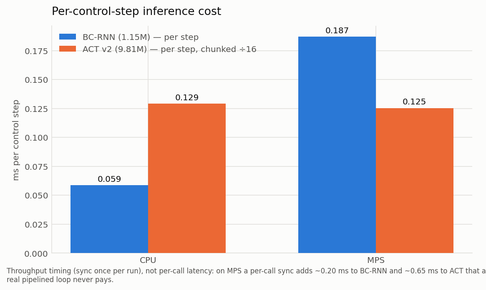

**Figure 6.10:** Per-control-step cost of the cheap and expensive policies on CPU and on MPS (throughput timing); the bars reverse order between devices. Evidence file: `docs/figures/latency.png`.

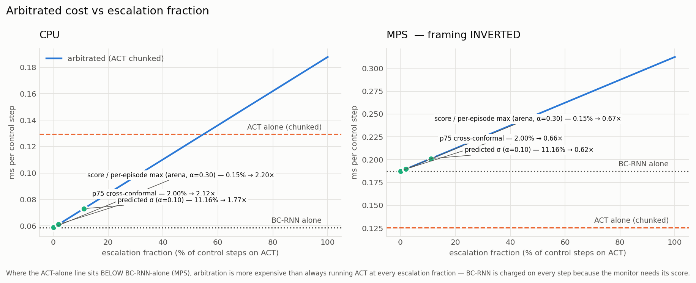

**Figure 6.11:** Arbitrated cost as a function of the escalation fraction on CPU (left) and MPS (right), with the BC-RNN-alone and ACT-alone reference lines and the three trigger operating points. Where the ACT-alone line sits below BC-RNN-alone (MPS), arbitration costs more than running ACT everywhere at every fraction. Evidence file: `docs/figures/cost_vs_escalation.png`.

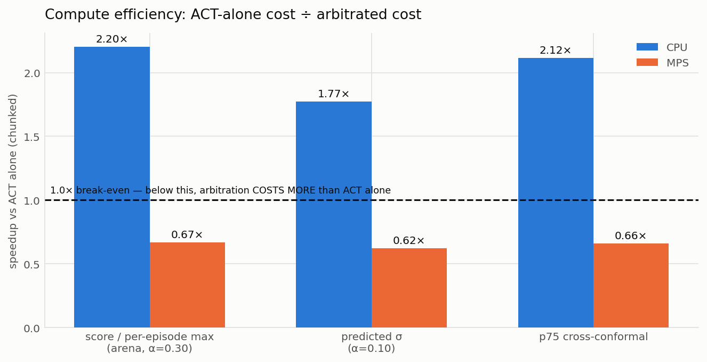

**Figure 6.12:** The ratio of ACT-alone cost to arbitrated cost at the three operating points, on CPU and on MPS, against the 1.0 times break-even line. Evidence file: `docs/figures/efficiency_summary.png`.

**Measurement method and a correction it forced.** Timing is throughput (one synchronisation per run) and not per-call latency, since MPS dispatch is asynchronous and calling `torch.mps.synchronize()` after every call charges a fixed tax (0.1987 ms to BC-RNN, 0.6552 ms to ACT) that a real pipelined control loop never pays. This was caught by an estimate-versus-direct cross-check. Built from per-call numbers, the additive cost model over-predicted a measured arbitrated replay by 39 % on MPS; built from throughput it agrees with the direct measurement (CPU 0.2758 against 0.2844 ms per step, error 3.1 %; MPS 0.3978 against 0.4011 ms, error 0.8 %). The cost model was right and the measurement method was wrong. The project's status document and the benchmark README, written from an earlier pass, quote slightly different CPU figures (1.80–2.25 times); the figures above are read from the JSON that produced the charts.

**Caveats that travel with these numbers.** They are Apple-Silicon-specific; a CUDA device with different launch overhead could land anywhere. Chunked pricing is the headline and per-step pricing (what the viewer does so that it can show ACT's opinion at every step) is an upper bound that differs by up to 16 times. The arbitrated cost is attributed cost, the cost the system would incur given the arm the arbiter selected, not the viewer's wall-clock time. And nothing here is a fidelity claim about which policy predicts a human better.

### THE ROBOTURK CALIBRATION

On the full RoboTurk Sawyer Tower Creation release (551 demonstrations, of which 531 are usable after dropping 20 with no grasp transition), the pooled-window empty-phase rate for $K = 2$ categories (gripper closed and open) is 0 of 531 after filtering. A state-only BC-RNN trained for 15 epochs (validation negative log-likelihood −6.21 at epoch 1 and −13.02 at epoch 15, tracking training with no overfitting). Calibration used 79 calibration and 80 evaluation episodes from a 30 % hold-out never seen in training. Because RoboTurk has no failure labels, this track makes no claim about detecting real failures, and its score (predicted against demonstrated joint-target action) is a different quantity from the LIBERO score. Its value is what it taught about the score and the aggregation.

**Table 6.12: RoboTurk calibration, successive passes** (`roboturk/RoboTurk_BCRNN_Findings.md`, `partD.json`, `partD_v2.json`, `cross_conformal.json`; $\alpha = 0.10$, $K = 2$, $\alpha_k = 0.05$, $n_{cal} = 79$, feasible)

| Pass | Score and statistic | $q$ closed / open | Evaluation coverage | Note |
|---|---|---|---|---|
| 1 | 8-dimensional action error including the grasp indicator, per-episode `max` | 2.284 / 2.211 | 1.000 | The grasp indicator entered the L2 norm unnormalised and owned a median 98.5 % of the squared error at the threshold-setting step, in 83 % of calibration episodes |
| 2 | 7 continuous dimensions only, `max` | 2.2005 / 2.1862 | 1.000 | Evaluation maximum was 1.213 / 1.198, so the thresholds sit far above anything the nominal evaluation episodes reach |
| 3 | 7 continuous dimensions, `max`, 2,000 random 79/80 partitions | median 1.023 / 1.546 | mean 0.951 / 0.950 | The single shipped partition had put every outlier episode into calibration; coverage over partitions matches the 0.95 per-category target |

Two lessons follow. Scoring the grasp indicator in a norm with continuous joint errors is wrong, and fixing it was necessary, but it was not what made the threshold uninformative: relocating the argmax meant the threshold barely moved (2.284 to 2.2005). The aggregation was the larger factor, since the pooled per-timestep continuous error is heavy-tailed (median 0.081, 90th percentile 0.204, 99th percentile 1.457, maximum 5.353), so a per-episode maximum over roughly 2,500 timesteps is controlled by a single spike. Switching the per-episode statistic to the 75th percentile keeps every timestep in the data but stops one timestep from controlling the phase; with cross-conformal medians the escalation thresholds are 0.5087 (closed) and 0.2501 (open) and the trigger fires on 2.00 % of evaluation timesteps, against 0.00 % for the shipped `max` thresholds. That 75th-percentile threshold is an escalation trigger and a compute-budget heuristic, not a safety certificate: it certifies only that at most a quarter of a nominal episode's timesteps exceed the threshold, and a median over partitions is a point estimate, not a certified split-conformal threshold. The safety guarantee remains with the per-episode `max` threshold.

On the continuous score, ACT v2 (9.8 million parameters, 20-frame history) is the better policy against BC-RNN (+7.7 % against +3.7 % for the 72.5-million-parameter, single-frame v1), a ranking that the contaminated 8-dimensional score had inverted. Using a deployable trigger (the BC-RNN's own predicted standard deviation, $\alpha = 0.10$), the escalation rate is 11.16 % with a safety-violation rate of 0.0, and an offline replay of arbitration recovers about 57–60 % of the prediction-error gap between BC-RNN and ACT at escalation fractions of 4.8 %, 11.2 % and 24.5 % (`partD_corrected.json`).

## 6.5 AUXILIARY STUDY: A CLOSED-LOOP STACKING TASK

A closed-loop MuJoCo "Tower Creation" environment (three cubes, Panda, 20 Hz control, 500 Hz physics) was built so that learned cheap and expensive policies could be arbitrated on a task with a stacking success predicate. The infrastructure works: a scripted expert builds the tower in 8 of 8 attempts and reaches 90 % success over 50 evaluation episodes, 344 of 400 demonstrations with noise injection succeeded, and the joint-target bridge to robosuite's controller is verified (replaying the recorded expert actions open-loop reproduces a tower).

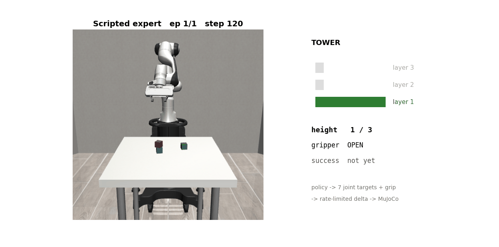

**Figure 6.13:** The closed-loop tower environment with the scripted expert at step 120 of an episode (tower height 1 of 3, gripper open). Evidence file: `docs/figures/tower_scripted_expert.png` (frame 60 of `data/results/tower_expert.gif`).

The learned policies trained on this demonstration set (a BC-RNN and an ACT, with absolute or end-effector-relative cube observations and with or without DART noise) did not complete the task in closed loop: 0 successes in every variant tried (0 of 8 to 0 of 20 episodes per variant). The diagnosis is the result. The supervision is one-to-many: the expert carries hidden state (which cube is next) that the observation does not, so among nearest-neighbour states drawn from other episodes 44 % want a different target cube and 37 % of the dataset's total action variation survives among states the network cannot tell apart. A regressor answers a one-to-many mapping with the mean of the branches, which puts the gripper about 8 cm from either of two candidates 16.5 cm apart; the measured close distances were 12.5 to 24.7 cm. The multimodality was destroyed by the objective, not discarded by the decoder (the gating of BC-RNN's 5-mode mixture puts a median 96.7 % of its mass on one component). The single recommended change is to make the intended target cube explicit in the observation, which turns the one-to-many mapping into a function. Because two arms that both do not complete the task would arbitrate to the same outcome, arbitration was not run on this task.

---

# CHAPTER 7: HARDWARE DEMONSTRATION

## 7.1 PURPOSE AND SCOPE

Chapters 5 and 6 are simulation results. This chapter describes the first physical stage: a low-cost demonstration of the monitoring path on a 3D-printed servo arm driven by an on-board edge computer. It is an illustrative proof of concept for the project's central idea, that the phase structure which conditions calibration comes from the gripper state and that the runtime logic is light enough to run beside the arm. It is not a validation experiment: no conformal calibration was performed on the physical arm and no statistics are reported from it (Section 7.7).

Facts in this chapter come from three sources and are kept apart: what the authors have stated about the build, what the photograph in Figure 7.2 shows, and what the repository's code does. Where a build detail exists only with the authors it is written as `[CONFIRM: ...]`, and every such field is collected in Appendix D so that none is left in the submitted copy by accident.

## 7.2 SYSTEM ARCHITECTURE

The architecture follows the host/edge split of the project design. Calibration is offline: successful rollouts are scored, thresholds are computed and everything is frozen into one calibration artefact (Section 4.7). At runtime the edge side needs only three light components, none of which imports a simulator:

1. a **phase tracker**, the causal labeller of `scripts/monitor.py`, which turns the stream of gripper open/closed values into reach, grasp, transport and release labels at a fixed five-step lag;
2. a **monitor and arbiter** (`scripts/monitor.py`, `scripts/arbiter.py`), which compare a score against the thresholds in force for the current phase and decide which policy acts;
3. a **cheap policy**, a small network that proposes the next action.

**Figure 7.1: Hardware demonstration, data path** (text diagram)

```
   gripper-state switch  ---- open / closed ---->  phase tracker (causal labeller, 5-step lag)
                                                         |
                                                         v
   cheap policy (on-board)  ---- action ---->  servo commands  ---->  3D-printed servo arm
         ^                                               |
         |                 monitor + arbiter  <----- phase, (score), thresholds from the frozen artefact
         +---- observation ----------------------------+
```

The expensive policy of the arbitration design is not part of this stage; Section 7.7 states what the demonstration includes and omits.

## 7.3 THE ARM PLATFORM

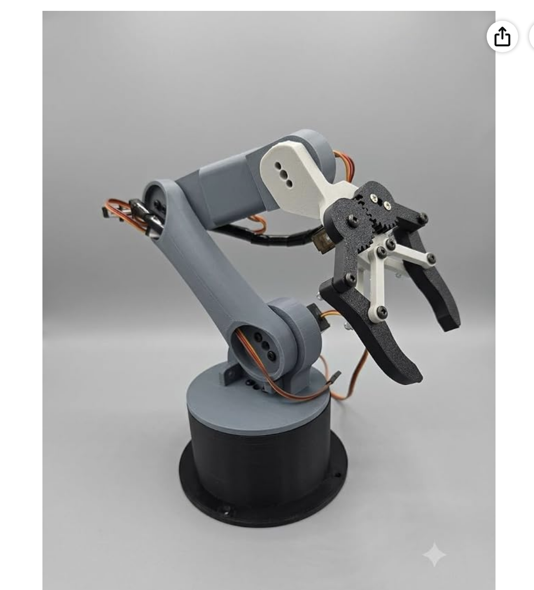

**Figure 7.2:** The 3D-printed desktop arm used as the hardware platform, shown in a reference image. [CONFIRM: replace this reference image with a photograph of the assembled unit; the supplied image carries a watermark in its lower-right corner and should not stand as evidence of the build.] Evidence file: `docs/figures/hw_arm_reference.png`.

**What the image shows.** The description below is limited to what is visible; the brand, model and printed-part source are not readable from the image and are not stated.

**Table 7.1: Observed features of the arm platform** (from Figure 7.2 only)

| Feature | Observation |
|---|---|
| Base | A black cylindrical base with a flat mounting flange carrying bolt holes, topped by a gray rotating plate |
| Links | A serial arm: a gray lower link rising from the base, a gray box-section upper link joined at an elbow, and a white wrist bracket with a pattern of holes |
| Joints | A shoulder, an elbow and a wrist joint are visible, each driven by a servo mounted at the joint; a base-rotation stage is implied by the turntable `[CONFIRM: number of degrees of freedom]` |
| Gripper | A black two-finger parallel gripper with visible meshing spur gears and white linkages, opened wide in the image |
| Actuators and wiring | Servo leads in orange, red and brown run through cable sleeves along the links `[CONFIRM: servo models and torque ratings]` |
| Construction | Printed plastic parts in three colours (gray, white, black), assembled with visible socket-head screws `[CONFIRM: material, printer, print settings, source of the part files and its licence]` |

Two engineering consequences follow from the three-wire (signal, power, ground) leads that are characteristic of PWM hobby servos. First, such servos accept a target angle but report no measured angle, so on this platform the executed end-effector motion is not directly measured; the compliance residual of Chapter 3 compares a planned setpoint with a measured pose, so computing it on hardware needs a pose measurement the base platform does not supply (Section 7.9). Second, a hobby-servo arm has no joint-torque sensing and a very different dynamic response from the simulated OSC controller, so thresholds calibrated in simulation do not carry over; the arm must be calibrated on its own nominal rollouts. Neither point reduces the demonstration's purpose, but both bound what it can claim.

## 7.4 THE GRIPPER-STATE SWITCH

The gripper open/closed state is supplied by a switch. This is the exact input the phase tracker consumes. In the simulator the tracker reads a single quantity, the sign of the gripper command: a step is labelled *transport* when the gripper is closed and *reach* when it is open, and the windows around each transition are relabelled *grasp* (open to closed) and *release* (closed to open). A binary signal is therefore sufficient to drive the phase labelling of Chapter 3, and a switch reproduces it faithfully, with the gripper state set by the operator at the moment of grasping and releasing. It makes the phase transitions explicit and visible to an audience.

What the switch is and is not: it stands in for a gripper command or sensor. It does not measure whether the object is actually held, so the phase labels it produces follow the operator's intent and not a verified grasp. Two practical points apply to any mechanical switch feeding a labeller that treats every change of state as a phase transition, and they are design considerations rather than recorded facts about this build: contact bounce must be removed before the signal reaches the tracker, because a spurious open/closed pair would create a spurious grasp or release window; and the five-step label lag means a phase label is final only five control steps after the switch changes `[CONFIRM: control rate used on the board, and whether debouncing is implemented in hardware or software]`.

`[CONFIRM: switch type, the input pin or channel it is wired to, and the pull-up or pull-down arrangement.]`

## 7.5 COMPUTE AND SOFTWARE ON THE BOARD

An on-board edge computer, a Jetson or a Raspberry Pi `[CONFIRM: exact board model and memory]`, runs the cheap policy and drives the servos directly. The design reason for an edge board is the cost structure of the project: the cheap policy is meant to carry most of the load, so it must run beside the arm, while the expensive policy is the component that would need a larger host. The cheap policy family in the project ranges from a 755-parameter network (a 26→16→16→3 MLP, 0.0218 ms per step on the laptop CPU used for the simulation experiments) to the 1,150,037-parameter BC-RNN (0.0585 ms per step on the same CPU, Chapter 6). The network deployed on the board is `[CONFIRM: which cheap model, its parameter count, and its input and output mapping to servo angles]`. On-board timing has not been measured; the Jetson latency benchmark is the first open hardware item (Conclusion and Future Work). For scale only: the control period of the simulated tasks is 40 to 50 ms, against laptop-CPU inference times of 0.02 to 0.06 ms for these networks.

The calibration artefact the runtime loads is read-only, as in the simulator: the board never recomputes thresholds at run time.

## 7.6 THE DEMONSTRATION TASK

**Task.** A tabletop pick-and-place: the arm reaches to a single lightweight object on the table, grasps it, carries it to a marked tray and releases it. The task is chosen because it passes through all four phase types in order, so each phase label appears on the display in sequence and the switch's role is visible at both gripper transitions. `[CONFIRM: the object, the tray position and the table layout.]`

**Planned procedure.** The run is planned for the 22 October 2026 expo, in this order:

1. Power the arm and the board; load the cheap policy and the calibration artefact.
2. With the switch open, start the run. The phase display reads *reach* while the arm moves toward the object.
3. At the grasp, the operator closes the switch. The tracker marks the grasp window and then *transport*; the arm carries the object toward the tray.
4. At the tray, the operator opens the switch. The tracker marks the release window and the run ends or returns to *reach*.
5. The display shows the phase and the policy in use throughout.

`[CONFIRM: what the on-screen display shows on the board's run (phase banner, policy in use, score if available).]`

## 7.7 WHAT THE DEMONSTRATION SHOWS AND WHAT IT LEAVES TO SIMULATION

**Table 7.2: Scope of the hardware demonstration**

| Element | In the hardware demonstration | Evidence for it |
|---|---|---|
| A 3D-printed servo arm as the physical platform | Yes | Figure 7.2; authors' statement |
| A cheap, low-cost policy running on an on-board edge computer that drives the servos | Yes | Authors' statement `[CONFIRM: which model and board]` |
| Gripper open/closed supplied by a switch to the phase tracker | Yes | Authors' statement; the tracker's input is the gripper-command sign (Section 3.3) |
| Phase labelling by the same causal labeller as in simulation | Intended; `[CONFIRM: whether the board runs this module as-is]` | `scripts/monitor.py`, tested against the offline segmenter in simulation (Section 4.4) |
| Conformal thresholds calibrated on the physical arm | No | Calibration is described in Chapters 3 and 5 for simulated rollouts |
| A coverage or false-alarm guarantee for the physical arm | No | Requires nominal physical rollouts and exchangeability on the arm |
| Measured end-effector pose and the compliance residual on hardware | No | Needs a pose measurement (Section 7.9) |
| Escalation to an expensive policy on hardware | No | The expensive policy is evaluated in simulation (Chapter 6) |

The demonstration therefore evidences the low-cost runtime path (an edge-resident cheap policy with a phase tracker driven by an external gripper-state signal) and nothing more. Every statistical claim of this report is a simulation result and is reported as such; the physical arm is the platform on which those results will be reproduced in the next stage.

## 7.8 BUILD RECORD

The following record is to be completed from the authors' build log. Rows whose value is known from the statements above are filled; every other cell is a fill-in field, since no build log, bill of materials or firmware exists in the project repository.

**Table 7.3: Build record**

| Item | Record |
|---|---|
| Arm type | 3D-printed serial desktop arm with a two-finger gear-driven gripper (observed) |
| Arm brand, model or open-source design name | `[CONFIRM]` |
| Source and licence of the printable part files | `[CONFIRM]` |
| Printer, material, layer height, infill | `[CONFIRM]` |
| Degrees of freedom | `[CONFIRM]` |
| Servo models (joints and gripper) and torque ratings | `[CONFIRM]` |
| Edge board (Jetson or Raspberry Pi) and model | `[CONFIRM]` |
| Servo driver or PWM generation method | `[CONFIRM]` |
| Power supply for servos and for the board | `[CONFIRM]` |
| Gripper-state switch type and wiring | `[CONFIRM]` |
| Cheap policy deployed | `[CONFIRM]` |
| Control rate on the board | `[CONFIRM]` |
| Software on the board (operating system, language, libraries) | `[CONFIRM]` |
| Servo-angle calibration and mapping from policy output to joint angles | `[CONFIRM]` |
| Total hardware cost | `[CONFIRM]` |
| Assembly and test dates | `[CONFIRM]` |

## 7.9 FROM DEMONSTRATION TO VALIDATION

Taking the hardware from demonstration to validation needs four changes, in order of dependency:

1. **A measured executed pose.** Replace or supplement the open-loop hobby servos with position read-back (for example serial-bus servos that report their angle) or an external measurement such as a camera, so that a planned-versus-executed score can be computed on the arm.
2. **A physical calibration set.** Record at least 79 nominal rollouts of the arm per task (the second feasibility bound of Section 3.4 for $K = 4$ at $\alpha = 0.10$), at one fixed policy and one fixed set-up, and apply the same pre-registered calibration procedure.
3. **A gripper sensor in place of the switch,** so that phase labels follow the actual grasp and not the operator's intent.
4. **On-board timing and the expensive arm.** Measure end-to-end latency of the cheap policy, monitor and phase tracker on the board, and connect an expensive policy (on a host over the network) to exercise escalation on hardware.

---

# CHAPTER 8: DISCUSSION

## 8.1 WHAT THE EVIDENCE SUPPORTS

**Table 8.1: Register of claims, their status and their limits**

| No. | Claim | Status | Evidence | Limit that travels with it |
|---|---|---|---|---|
| 1 | Stage-aware thresholds are tighter than a flat threshold at target coverage | Supported on 3 of 3 tasks | Table 5.4: ratios 0.990, 0.892, 0.926 | Needs the calibration set to clear $n \ge 79$ per phase; the band summary is defined in a package outside this repository |
| 2 | Stage-aware monitoring detects more failures at matched false-alarm rate | Supported in the window FAR ≤ 0.15 | Table 5.5, Figure 5.2: all three tasks positive; mean +0.068, +0.095, +0.044 at 0.05, 0.10, 0.15 | Three tasks, not sixty; tasks disagree at FAR ≥ 0.20; infeasible below about 0.05; the earlier implementation differs in magnitude (Table 5.6) |
| 3 | Held-out coverage is near the 0.90 target | Supported | §5.5: 0.89–0.92 on three tasks, 100 % feasibility | Initial-state pool is a disclosed mixture of shipped and generated states |
| 4 | The calibration unit must be the per-trajectory phase maximum, with $n \ge 39$ (finite) and $n \ge 79$ (below the sample maximum) | Supported | Sections 3.4, 5.5 | The 79 bound is what decides efficiency; at the default calibration fraction the stage-aware arm was wider |
| 5 | A second threshold bounds the spurious-escalation rate | Supported | Chapter 3; Table 6.6 (4.7 pp mean deviation) | A bound on unnecessary escalation, not on safety of the arbitrated trajectory |
| 6 | The escalation budget holds under an easy-to-hard shift when recalibrated on unlabelled scores | Supported in MuJoCo, 92 test episodes | Table 6.6, Figure 6.2 | Regime exclusion is partial ($R^2$ 0.998 to 0.395) |
| 7 | Arbitration improves on the cheap policy at low expert cost | Supported | Tables 6.7, 6.10: 0.680 to 0.82–0.885 (MuJoCo); 0.436 to 0.530 (panda-gym, 85 % fewer expert calls) | Far below expert-only in both tracks |
| 8 | Calibrated timing beats random timing at equal cost | **Not supported** | Table 6.8: $p$ = 1.000, 0.163, 0.851; panda-gym +0.026, $p$ = 0.24 | Holds even with a decision-time AUC of 0.813 |
| 9 | Arbitration reduces compute | Supported on CPU, not on the Apple GPU | Table 6.11: 1.77–2.20× on CPU; 0.62–0.67× on MPS | Apple-Silicon-specific; chunking, not parameter count, decides per-step cost |
| 10 | An arbitrated trajectory is certified safe | **Not claimed** | Section 3.6 | The coverage guarantee does not transfer to the arbitrated trajectory |
| 11 | The low-cost runtime path runs on physical hardware | Demonstrated at proof-of-concept level | Chapter 7 | No calibration, coverage or detection result on the physical arm |

## 8.2 WHAT BOUNDS THE CLAIMS

**Unit of replication.** The 20 resampled splits per task measure split variance, not independent evidence. The honest sample size for any statement about the method across tasks is three tasks. All three agree at the operating point of interest, which is encouraging, and three is three.

**Operating window.** The advantage of stage-aware thresholds exists in a bounded window, and it is bounded on both sides: above FAR 0.15 the tasks disagree, and below about 0.05 the Bonferroni floor makes the stage-aware arm infeasible with the available calibration data. A deployment that needs very low false-alarm rates would need more calibration rollouts per phase.

**Task 8.** At 0.853 success the policy is outside the 40–80 % band, so only 22 failures are available. It is included because it is the only task outside the living-room scene, and it contributes less to the precision of the detection estimates than the other two.

**Exchangeability.** The guarantee is conditional on the data-generating process being constant. This is protected by the frozen checkpoint, the environment fingerprint and the initial-state handling, but the initial-state pool for the three production files mixes shipped and generated states. No significant difference was found (pooled KS $p = 0.47$), and mixture thresholds are lower than shipped-only ones, which is the conservative direction, but the coverage claim is with respect to that mixture.

**Lead time.** Every failure ran to the 600-step cap, so lead times (265–460 median steps) and any duration-based detection are inflated by the cap. They show that alarms come early relative to the episode's end, not how early relative to the onset of failure.

**Phase labels depend on the gripper.** The labelling is clean for tasks with two grasp cycles and degrades for tasks with many (RoboTurk Tower Creation has a median of about 8 grasp cycles, and in the LeRobot mirror of that dataset 5.7 % of its episodes had an empty phase category before filtering). Three task-0 rollouts lack a phase, all failures.

**Arbitration timing.** Calibrated timing was indistinguishable from random timing at matched usage in two independent tracks. The diagnostics point to the push expert's ability to rescue from almost any step, to a trigger that fires around the phase boundary, and to a hand-back rule that returns control before the expert's rescue window closes. These are explanations offered with data, and testing them (a different trigger, permanent escalation) is future work.

**Policies and simulators.** The MuJoCo push expert has a single training seed, and its 0.930 is conditional on a proportional-servo hand-off. The MuJoCo controller uses non-physical force limits to match a reference system, which is right for sim-to-sim comparison and not for sim-to-real. The panda-gym horizon gate was passed only through an authorised override, which is stated in the results.

**Hardware.** The physical arm is a demonstration platform, and its hobby-servo actuators report no measured angle. The conformal score of Chapter 3 therefore cannot be computed on the base platform without an added pose measurement.

**Provenance of numbers.** Four quantities appear in more than one place with different values or origins, and each was resolved to its result file or stated with its provenance: the CPU speed-ups of the compute benchmark (written as 1.80–2.25× in the benchmark README and status document, 1.77–2.20× in the JSON that produced the charts); the matched-FAR gain at FAR 0.15 (the earlier implementation +0.071, the pre-registered analysis +0.044); the push expert's success (0.930 for the final model, 0.950 for the best checkpoint, 0.925 for the composed pair); and the expert-usage figure "8 of 62 steps", which belongs to a recorded panda-gym episode replayed in MuJoCo and not to the native MuJoCo closed-loop runs, where the demonstration seeds use the expert on 47–71 % of steps.

## 8.3 METHODOLOGICAL LESSONS

1. **Check what a score is reading before using it.** Raw tracking error read out commanded speed (compliance) and ranked failures below successes; the RoboTurk grasp indicator owned 98.5 % of its error norm. In both cases the score measured a nuisance quantity.
2. **Compare at matched operating points.** Comparing at the same nominal $\alpha$ reversed the conclusion by up to 0.27 TPR.
3. **A high AUC is not sufficient for a trigger.** Value depends on whether the downstream action's payoff varies with timing.
4. **Suspect the measurement method as well as the model.** Per-call synchronisation on the GPU charged a fixed tax that a real loop never pays, and the estimate-versus-direct cross-check exposed it.
5. **Pre-register parameters that can be tuned to the outcome.** `cal_frac` and the gate thresholds were fixed before results; a gate that was missed at its boundary was reported and overridden in the open.
6. **Determinism is a precondition for paired tests.** Hidden simulator state across resets gave success flips on 7 of 40 seeds, and rebuilding the environment removed them.
7. **State the limits where the number is.** Each table in this report names its source file and the limit that goes with it.

---

# CONCLUSION AND FUTURE WORK

## CONCLUSION

This project built and evaluated a runtime monitor for long-horizon manipulation that conditions conformal calibration on the execution phase, and reused the calibrated signal to decide when an expensive policy is needed. On 450 rollouts of a frozen diffusion policy over three LIBERO-Long tasks, calibrating one threshold per phase on the per-trajectory phase maximum, with the risk budget split by Bonferroni, gave held-out coverage of 0.89 to 0.92 against a 0.90 target, thresholds tighter than a flat threshold on all three tasks, and more failures detected at matched false-alarm rate in the window up to a false-alarm rate of 0.15. A compliance-residual score removed the controller's confound, and a set of checks (feasibility bounds, motion floor, causal phase labelling proven equal to the offline labels, an environment fingerprint) made the guarantee operational rather than nominal.

The arbitration application behaves as designed in two respects and not in a third. A second, lower threshold bounds the spurious-escalation rate, and the budget survived an easy-to-hard shift in a native MuJoCo task (4.7 percentage points mean deviation against 52.5 for a fixed threshold). Arbitration improves clearly on a cheap policy at modest expert cost, and is 1.77 to 2.20 times cheaper than always running the expensive policy on CPU. But the calibrated trigger did not beat random escalation at matched expert usage, in two independent tracks, and the compute saving reverses on an Apple GPU. These are reported as findings, with the limits that go with them.

A hardware demonstration on a 3D-printed servo arm with an on-board edge computer, with a switch supplying the gripper open/closed state to the phase tracker, shows the monitoring path on low-cost hardware. It is a proof of concept for the runtime path; calibration and validation on the physical arm are the next stage.

## FUTURE WORK

Items are listed in priority order.

1. **Reconcile the two matched-FAR implementations.** The pre-registered analysis (Table 5.5) and the earlier ablation (Table 5.6) agree in sign at FAR ≤ 0.15 and differ in magnitude and in shape at higher FAR. Diff them line by line and report one number.
2. **Wave-2 collection.** A fourth task near 50 % success (about 200 rollouts, targeting about 99 successes and 99 failures), with uniform sampling with replacement from the shipped 100 initial states, after the noise-injection fix has been verified by a short probe and a noise-magnitude sweep.
3. **On-board benchmark.** Measure the latency of the cheap policy, monitor and phase tracker on the edge board; the Jetson latency benchmark needs no simulator, only a checkpoint and a saved observation, and decides whether the planned edge deployment is viable as specified.
4. **Real-data arbitration on LIBERO.** Train or obtain cheap and expensive arms for LIBERO and integrate the recorded rollouts into the arbitration replay harness, which is so far validated on synthetic data and in the separate MuJoCo task.
5. **A baseline from the literature.** Implement the FAIL-Detect baseline. It needs the recorded action chunks and images, which collection already stores because neither is recoverable afterwards.
6. **Replicate the aggregation choice.** Test the 95th-percentile aggregation on held-out data not used to select it, before it is adopted, and make evaluation nan-aware for rollouts with an empty phase.
7. **A trigger and de-escalation rule that use the timing window.** Test a stronger trigger and permanent (or much longer) escalation against random escalation on the reach-then-push task, whose rescue curve shows a graded window.
8. **Complete the MuJoCo-native benchmark.** Three-seed variance of the push expert, a learned reach expert in place of the proportional servo, and a refit of the push hand-off distribution to the learned reach expert.
9. **Hardware: from demonstration to validation.** Add a measured executed pose (servo position read-back or a camera), record at least 79 nominal rollouts of the arm per task for calibration, replace the switch with a gripper sensor, measure on-board latency, and connect an expensive policy on a host to exercise escalation on the arm (Section 7.9).

---

# REFERENCES

Agia, C., Sinha, R., Yang, J., Cao, Z., Antonova, R., Pavone, M., & Bohg, J. (2024). Unpacking failure modes of generative policies: Runtime monitoring of consistency and progress. *Conference on Robot Learning (CoRL)*.

Andrychowicz, M., Wolski, F., Ray, A., Schneider, J., Fong, R., Welinder, P., McGrew, B., Tobin, J., Abbeel, P., & Zaremba, W. (2017). Hindsight experience replay. *Advances in Neural Information Processing Systems, 30*.

Angelopoulos, A. N., & Bates, S. (2023). Conformal prediction: A gentle introduction. *Foundations and Trends in Machine Learning, 16*(4), 494–591.

Cadene, R., et al. (2024). *LeRobot: State-of-the-art machine learning for real-world robotics in PyTorch* [Computer software]. Hugging Face. https://github.com/huggingface/lerobot

Chen, L., Zaharia, M., & Zou, J. (2020). FrugalML: How to use ML prediction APIs more accurately and cheaply. *Advances in Neural Information Processing Systems (NeurIPS)*.

Chi, C., Feng, S., Du, Y., Xu, Z., Cousineau, E., Burchfiel, B., & Song, S. (2023). Diffusion Policy: Visuomotor policy learning via action diffusion. *Robotics: Science and Systems (RSS)*.

Doula, A., Mühlhäuser, M., & Sánchez Guinea, A. (2025). *SafePath: Conformal prediction for safe LLM-based autonomous navigation* [Preprint].

Gallouédec, Q., Cazin, N., Dellandréa, E., & Chen, L. (2021). *panda-gym: Open-source goal-conditioned environments for robotic learning* (arXiv:2106.13687). arXiv.

Gibbs, I., & Candès, E. (2021). Adaptive conformal inference under distribution shift. *Advances in Neural Information Processing Systems (NeurIPS), 34*, 1660–1672.

Gu, Q., Ju, Y., Sun, S., Gilitschenski, I., Nishimura, H., Itkina, M., & Shkurti, F. (2025). SAFE: Multitask failure detection for vision-language-action models. *Advances in Neural Information Processing Systems (NeurIPS)*.

Hsu, T.-W., & Tsukamoto, H. (2025). Statistical guarantees in data-driven nonlinear control: Conformal robustness for stability and safety. *IEEE Control Systems Letters*.

Khalili, L., You, Y., & Bohannon, J. (2022). *BabyBear: Cheap inference triage for expensive language models* (arXiv:2205.11747). arXiv.

Khatib, O. (1987). A unified approach for motion and force control of robot manipulators: The operational space formulation. *IEEE Journal on Robotics and Automation, 3*(1), 43–53.

Kuznetsov, A., Shvechikov, P., Grishin, A., & Vetrov, D. (2020). Controlling overestimation bias with truncated mixture of continuous distributional quantile critics. *Proceedings of the 37th International Conference on Machine Learning (ICML)*.

Lei, J., G'Sell, M., Rinaldo, A., Tibshirani, R. J., & Wasserman, L. (2018). Distribution-free predictive inference for regression. *Journal of the American Statistical Association, 113*(523).

Lindemann, L., Cleaveland, M., Shim, G., & Pappas, G. J. (2023). Safe planning in dynamic environments using conformal prediction. *IEEE Robotics and Automation Letters*.

Liu, B., Zhu, Y., Gao, C., Feng, Y., Liu, Q., Zhu, Y., & Stone, P. (2023). LIBERO: Benchmarking knowledge transfer for lifelong robot learning. *Advances in Neural Information Processing Systems (NeurIPS)*.

Mandlekar, A., Zhu, Y., Garg, A., Booher, J., Spero, M., Tung, A., Gao, J., Emmons, J., Gupta, A., Orbay, E., Savarese, S., & Fei-Fei, L. (2018). RoboTurk: A crowdsourcing platform for robotic skill learning through imitation. *Proceedings of the 2nd Conference on Robot Learning (CoRL)*, PMLR 87, 879–893.

McNemar, Q. (1947). Note on the sampling error of the difference between correlated proportions or percentages. *Psychometrika, 12*(2), 153–157.

Raffin, A., Hill, A., Gleave, A., Kanervisto, A., Ernestus, M., & Dormann, N. (2021). Stable-Baselines3: Reliable reinforcement learning implementations. *Journal of Machine Learning Research, 22*(268), 1–8.

Römer, R., Kobras, A., Worbis, L., & Schoellig, A. P. (2025). Failure prediction at runtime for generative robot policies (FIPER). *Advances in Neural Information Processing Systems (NeurIPS)*.

Sheng, S., Yu, P., Parker, D., Kwiatkowska, M., & Feng, L. (2024). Safe POMDP online planning among dynamic agents via adaptive conformal prediction. *IEEE Robotics and Automation Letters*.

Teerapittayanon, S., McDanel, B., & Kung, H. T. (2016). BranchyNet: Fast inference via early exiting from deep neural networks. *International Conference on Pattern Recognition (ICPR)*.

Tibshirani, R. J., Foygel Barber, R., Candès, E., & Ramdas, A. (2019). Conformal prediction under covariate shift. *Advances in Neural Information Processing Systems (NeurIPS), 32*.

Todorov, E., Erez, T., & Tassa, Y. (2012). MuJoCo: A physics engine for model-based control. *2012 IEEE/RSJ International Conference on Intelligent Robots and Systems*, 5026–5033.

Vovk, V., Gammerman, A., & Shafer, G. (2005). *Algorithmic learning in a random world*. Springer.

Wang, J., He, G., & Kantaros, Y. (2024). Probabilistically correct language-based multi-robot planning using conformal prediction. *IEEE Robotics and Automation Letters*.

Wilson, E. B. (1927). Probable inference, the law of succession, and statistical inference. *Journal of the American Statistical Association, 22*(158), 209–212.

Xu, C., et al. (2025). Can we detect failures without failure data? Uncertainty-aware runtime failure detection for imitation learning policies (FAIL-Detect). *Robotics: Science and Systems (RSS)*.

Xu, C., & Xie, Y. (2021). Conformal prediction interval for dynamic time-series. *International Conference on Machine Learning (ICML)*.

Zaffran, M., Féron, O., Goude, Y., Josse, J., & Dieuleveut, A. (2022). Adaptive conformal predictions for time series. *International Conference on Machine Learning (ICML)*.

Zhao, T. Z., Kumar, V., Levine, S., & Finn, C. (2023). Learning fine-grained bimanual manipulation with low-cost hardware (ACT). *Robotics: Science and Systems (RSS)*.

Zhao, Y., Hoxha, B., Fainekos, G., Deshmukh, J. V., & Lindemann, L. (2024). Robust conformal prediction for STL runtime verification under distribution shift. *ACM/IEEE International Conference on Cyber-Physical Systems (ICCPS)*.

Zheng, G., Seenivasan, S., Johnson-Roberson, M., & Zhi, W. (2026). *Rewind-IL: Online failure detection and state respawning for imitation learning* [Preprint].

Zhu, Y., Wong, J., Mandlekar, A., Martín-Martín, R., Joshi, A., Nasiriany, S., & Zhu, Y. (2020). *robosuite: A modular simulation framework and benchmark for robot learning* (arXiv:2009.12293). arXiv.

---

# APPENDICES

## APPENDIX A: COMMANDS

All live-pipeline commands run in `.venv-lerobot`; `uv run` gives the wrong environment (Section 4.1).

```bash
# environment
./scripts/setup/bootstrap.sh
uv venv --python 3.10 .venv-lerobot
uv pip install --python .venv-lerobot/bin/python -r requirements-lerobot.txt
uv pip install --python .venv-lerobot/bin/python -e third_party/LIBERO

# LIBERO monitoring pipeline
.venv-lerobot/bin/python -m scripts.collect_rollouts --task-id 0 --n-rollouts 150
.venv-lerobot/bin/python -m scripts.verify_spec  --rollouts data/rollouts/task0_v10.hdf5
.venv-lerobot/bin/python -m scripts.cp_monitor   --rollouts data/rollouts/task0_v10.hdf5 --alpha 0.1
.venv-lerobot/bin/python -m scripts.show_rollout data/rollouts/task0_v10.hdf5 -r 0
.venv-lerobot/bin/python -m scripts.gen_init_states --task-id 0 --n 160

# regenerate a per-task calibration artefact (seed 0, cal_frac 0.8)
.venv-lerobot/bin/python -m scripts.cp_monitor --rollouts data/rollouts/task0_v10.hdf5 \
    --alpha 0.1 --cal-frac 0.8 --alpha-esc 0.3 --beta 0.1 --out data/results/demo_task0.json

# the monitor viewer and demonstrations
./run.sh fail      # rollout 83: VIOLATION at step 40
./run.sh safe      # rollout 41: SAFE throughout
./run.sh stall     # rollout 76: STUCK
./run.sh versus    # flat CP against per-phase CP on the same failure
./run.sh sawyer    # RoboTurk BC-RNN to ACT arbitration
./run.sh tower     # scripted expert builds the tower
./run.sh test      # test suite

# tests run for this report
.venv-lerobot/bin/python -m pytest -q tests                              # 35 passed
cd handout_mujoco && PYTHONPATH=live ../.venv-lerobot/bin/python live/test_envs.py   # 37/37 checks passed

# MuJoCo-native reach-then-push
cd handout_mujoco
PYTHONPATH=live ../.venv-lerobot/bin/python live/arena_reach_push.py --save arena.mp4
python live/tune_controller.py        # the 60-configuration controller sweep

# RoboTurk compute benchmark and charts
.venv-lerobot/bin/python roboturk/compute_benchmark.py
.venv-lerobot/bin/python roboturk/benchmark_charts.py
```

## APPENDIX B: REPOSITORY MAP

**Table B.1: Repository map**

| Path | Contents |
|---|---|
| `scripts/` | The pipeline code: collection, phase segmentation, monitor, arbiter, viewer, fingerprint, calibration |
| `scripts/policies/` | Policy adapter interface and the diffusion and BC-Transformer adapters |
| `scripts/probes/`, `scripts/setup/` | One-shot measurements (action space, tracking gain, timing); bootstrap and the LIBERO macOS patch |
| `tests/` | `test_arbiter.py` (9), `test_monitor.py` (18), `test_policies.py` (8) |
| `data/rollouts/` | `task{0,1,8}_v10.hdf5` (450 rollouts) and `session_log.json` |
| `data/results/` | Calibration artefacts (`demo_task*.json`), verification and ablation results, demonstration videos |
| `docs/` | Technical report, verification report, status, this report, plans and specs under `docs/superpowers/` |
| `docs/figures/` | The images used as evidence in this report (Appendix C) |
| `handout_mujoco/` | Native MuJoCo reach-then-push system: `live/` (environments, arbiter, arena), `training/`, `analysis/`, `results/` (reports, JSON, charts), `samples/` (recorded replays) |
| `composed/` | panda-gym composition studies: sub-skill verification, rescue curves, benchmark |
| `roboturk/` | RoboTurk BC-RNN and ACT, calibration passes, compute benchmark |
| `third_party/` | The LIBERO clone (gitignored, rebuilt by the bootstrap) |
| `run.sh`, `requirements-lerobot.txt` | Command dispatcher; the frozen environment |

## APPENDIX C: EVIDENCE INDEX

Every image used as evidence is under `docs/figures/`. Charts marked "redrawn" were drawn from the values in the cited table or JSON file; the others are copies of repository images or stills extracted from repository videos.

**Table C.1: Figure index**

| Figure | File in `docs/figures/` | What it shows | Origin | Supports |
|---|---|---|---|---|
| 5.1 | `libero_success_rates.png` | Success rate per task with Wilson intervals and the 40–80 % band | Redrawn from `docs/status.md` §5 counts | Policy outcomes (Table 5.1) |
| 5.2 | `libero_matched_far_gain.png` | Detection gain of stage-aware over flat thresholds at matched FAR, per task and mean | Redrawn from `docs/status.md` §6.2 | Claim 2 |
| 5.3 | `libero_monitor_success_r41.png` | Monitor view of a successful held-out rollout (SAFE) | Frame 130 of `data/results/demo_r41.mp4` | Monitor behaviour on success |
| 5.4 | `libero_monitor_violation_r83.png` | Monitor view of a failing rollout (VIOLATION at step 40, STUCK at step 293) | Frame 300 of `data/results/demo_r83.mp4` | Monitor behaviour on failure |
| 6.1 | `controller_tuning.png` | MuJoCo controller sweep against the reference 0.655 | `handout_mujoco/results/controller_tuning.png` | Controller match (Table 6.1) |
| 6.2 | `mujoco_budget_compliance.png` | Realised escalation rate under an easy-to-hard shift, fixed against conformal | Redrawn from `results/mujoco_train/shift_rate_control.json` | Claim 6 |
| 6.3 | `mujoco_arbitration_frontier.png` | Success against expert usage, arbitrated and random | Redrawn from `results/mujoco_train/arbitration_eval.json` | Claims 7 and 8 |
| 6.4 | `mujoco_arena_cheap_seed400167.png` | Live arena, cheap policy acting, SAFE | Frame 60 of `results/mujoco_train/arena_reach_push.mp4` | Native closed-loop operation |
| 6.5 | `mujoco_arena_expert_seed400169.png` | Live arena, expert acting after escalation, episode SUCCESS | Frame 178 of the same video | Native closed-loop escalation |
| 6.6 | `rescue_curve.png` | Rescue curves of Reach-then-Slide and Reach-then-Push | `handout_mujoco/results/rescue_curve.png` (shared-environment run) | Gate analysis |
| 6.7 | `phase_boundary_frames.png` | Composed episodes at reset, boundary and end | `composed/results_push/figures/phase_boundary_frames.png` | Composition validity |
| 6.8 | `mujoco_replay_strip_seed230044.png` | Arbitrated episode, panda-gym recording replayed in MuJoCo | `handout_mujoco/samples/preview_arbitrated_seed230044.png` | Illustration; a replay, not a native run |
| 6.9 | `shift_rate_control.png` | Budget compliance in the earlier panda-gym system | `handout_mujoco/results/shift_rate_control.png` | Earlier-system analogue of Claim 6 |
| 6.10 | `latency.png` | Per-step cost, CPU against MPS | `roboturk/benchmark/latency.png` | Claim 9 |
| 6.11 | `cost_vs_escalation.png` | Arbitrated cost against escalation fraction | `roboturk/benchmark/cost_vs_escalation.png` | Claim 9 |
| 6.12 | `efficiency_summary.png` | ACT-alone over arbitrated cost against break-even | `roboturk/benchmark/efficiency_summary.png` | Claim 9 |
| 6.13 | `tower_scripted_expert.png` | Closed-loop tower environment with the scripted expert | Frame 60 of `data/results/tower_expert.gif` | Auxiliary study |
| 7.2 | `hw_arm_reference.png` | The 3D-printed servo arm (reference image) | Image supplied by the authors | Hardware platform; to be replaced by a photograph of the assembled unit |

**Videos and animations cited** (not embedded): `data/results/demo_r41.mp4`, `data/results/demo_r83.mp4`, `data/results/demo_live.mp4` (LIBERO monitor replays); `handout_mujoco/results/mujoco_train/arena_reach_push.mp4` (native MuJoCo live arena); `handout_mujoco/samples/mujoco_{cheap,expert,arbitrated}_seed230044.mp4` and four other arbitrated seeds (kinematic replays); `handout_mujoco/reference/pybullet_arbitrated_a0.30_seed230044.mp4` (the matching PyBullet recording); `data/results/tower_expert.gif`. The file `data/results/demo_r76.mp4` (the stall case) is incomplete and cannot be read by ffmpeg; it can be re-rendered with `./run.sh record`.

**Result files cited:** `data/results/{demo_task0,demo_task1,demo_task8,verification_task0,pretrained_dp_task*}.json`, `data/rollouts/session_log.json`, `handout_mujoco/results/mujoco_train/{arbitration_eval,shift_rate_control,calibration,cheap_policy*,inference_latency}.json|md`, `handout_mujoco/results/efficiency_summary.json`, `roboturk/benchmark/compute_benchmark.json`, `roboturk/{partD,partD_v2,partD_corrected,cross_conformal}.json`.

## APPENDIX D: FIELDS TO COMPLETE BEFORE SUBMISSION

Every `[CONFIRM: ...]` marker in this report stands for a fact that is not recorded anywhere in the project repository and exists only with the authors. None has been filled with a guess. Search for `CONFIRM` and resolve each one; then delete this appendix.

**Table D.1: Front matter**

| Where | Field |
|---|---|
| Declaration, Certificate, Acknowledgement | Guide's name and designation |
| Declaration, Certificate | Submission date; examiners' names and dates; Head of Department's name and date |
| Acknowledgement | The remaining names and designations of the institutional paragraph after "Dr. T. Thyagarajan", exactly as in the official template |
| Cover and title page | Confirm "October, 2026" as the report month, and the programme name "Computer Science and Engineering with specialization in Artificial Intelligence and Robotics" |

**Table D.2: Hardware demonstration (Chapter 7)**

| Where | Field |
|---|---|
| Figure 7.2 | A photograph of the assembled unit, to replace the reference image |
| Table 7.3, Section 7.3 | Arm brand, model or open-source design name; source and licence of the part files; printer, material, layer height, infill; degrees of freedom; servo models and torque ratings |
| Table 7.3, Section 7.5 | Edge board (Jetson or Raspberry Pi) and memory; servo driver or PWM generation; power supply; operating system, language and libraries; control rate |
| Table 7.3, Section 7.4 | Switch type, input pin or channel, pull-up or pull-down arrangement; debounce (hardware or software) |
| Table 7.3, Sections 7.5 and 7.7 | Which cheap policy is deployed, its parameter count, and how its output maps to servo angles; whether the board runs the project's phase-tracker module as is |
| Section 7.6 | The object, the tray position, the table layout, and what the display shows during the run |
| Table 7.3 | Servo-angle calibration method; total hardware cost; assembly and test dates |

**Table D.3: Items to verify rather than fill**

| Item | Check |
|---|---|
| References | The 24 literature entries were taken from the Review 2 reference list, and the entries for LeRobot and FAIL-Detect use "et al."; expand to full author lists, and confirm volume, pages and DOIs, where APA 7 requires |
| Declaration and Certificate wording | The Certificate follows the wording supplied with the report template; the Declaration follows the standard form and should be checked against the institutional template |
| Matched-FAR number | Table 5.5 (pre-registered, +0.044 at FAR 0.15) and Table 5.6 (earlier implementation, +0.071) differ; the Review 3 presentation quoted +0.071. Decide which is cited as the headline after the implementations are reconciled |
| Expert-usage example | The "8 of 62 steps" example is a replay of a panda-gym recording (Figure 6.8); the native MuJoCo demonstration seeds use the expert on 47–71 % of steps |
| Page count | Export to A4 with the template's margins, font and spacing and confirm the page count is between 60 and 100 |
